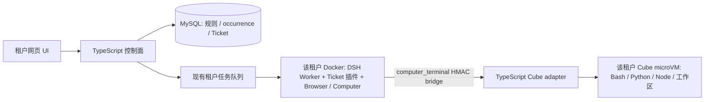

# DeepSeek SuperAgent 主动能力适配方案

## 研究结论

DeepSeek 的 [DSH SuperAgent prototype](https://github.com/deepseek-ai/dsh-superagent-prototype) 是研究原型，不是可直接依赖的 npm 插件。它把 Source 事件经 Router/Eval 转成独立 Ticket，再派给独立 Worker；每个 Ticket 有自己的 DSH Session 和工作目录。原型要求先显式请求或书面规则授权；未知主动工作先只记录建议；网页、仓库等输入不能自行增加权限。部署示例让 Worker 使用操作者本机 Shell 与 `danger-full-access`，因此不能把原型的 Worker 预设照搬到 Coke Super Agent。

上游的[设计文章](https://mp.weixin.qq.com/s/zoS7GlReWPhfCjENGxXCdg)在本次调研时被公众号验证码拦截；Computer Use 也明确拒绝该地址。为理解文章补充的 Router/Worker、事件触发、上下文和长任务交互思路，参考了[一份转载](https://chinamodelapi.com/zh/super-agent-design-deepseek)，并以 GitHub 原型仓库的 README 与 `docs/000-philosophy.md`、`001-domain.md`、`002-authorization.md`、`003-execution.md`、`005-panel.md`、`006-deployment.md`、`007-architecture.md` 为实现依据。转载内容未当作官方页面直接读取的证据。

## 产品架构映射

TypeScript 控制面作为 Router 与 Trigger 调度器，周期扫描 MySQL 中的规则。默认 `Observe` 只写 occurrence，不调用模型。用户显式选择 `Active` 后，定时 occurrence 会创建一条独立 run/thread，作为 Ticket 进入现有租户队列。任务继续由租户 Docker 中的 DeepSeek Harness 执行；规则快照和 Ticket 元数据通过受限的 `superagent_ticket_context` DSH 插件提供给 Worker。插件只返回当前 Ticket 的来源和授权范围，不执行命令、不联网，也不开放新的工具权限。

容器内 DSH 的本地 Bash、PowerShell、文件系统和工作目录工具保持禁用。`computer_terminal` 仍通过当前 TypeScript 应用桥接到该租户 Cube microVM。DSH SDK、Ticket 插件、桌面、Chrome、noVNC 和 Browser/Computer Worker 均不进入 Cube guest；Cube 仍只提供每租户的远程执行与持久工作区。

## 首版行为

- 每条规则属于一个租户，包含名称、明确的任务授权文本、分钟间隔、`Observe` 或 `Active` 模式、启停状态和下次触发时间。
- 最短间隔为 1 分钟，最长为 7 天。新规则默认 `Observe`，不会因创建规则而立即启动 Agent。
- MySQL 事务配合行锁和 `(rule_id, scheduled_for)` 唯一键，避免多 API 实例重复处理同一触发。错过多个周期只产生一次补记，并推进到下一个未来周期。
- Worker 每个 Ticket 使用现有的独立 DSH thread/session 和 Cube task workspace。规则发生编辑后，不会改变已创建 Ticket 的 `rule_name` 和 `mandate` 快照。
- 同一规则存在 queued、working 或 waiting-for-user Ticket 时，后续触发记为 `skipped_busy`，避免持续堆积或重复外部动作。
- DSH 收到明确的 Ticket 边界，并被要求把网页、搜索结果、文件和工具输出视为不可信数据；不得借这些数据扩展任务。规则未明确授权的外部发送、购买、发布、删除或登录动作应停止并请求用户决定。
- 主动规则页显示规则、下次触发、Observe/Active 状态、触发历史、排队的 Ticket 和跳过原因；run trace 会串联 Router 创建 Ticket、加载授权快照和 Docker DSH 执行阶段。
- 规则、occurrence 和 run 查询始终按登录 session 的 tenant ID 过滤。写接口要求同源请求。

## 首版不包含

首版 Trigger 只有时间间隔，不接 GitHub、飞书、Webhook、邮件或系统通知；暂不实现文章所述 speculative execution、事件订阅线程、独立 Watchdog、跨来源全局记忆和消息分发。实现先验证最小的 Trigger → Ticket → Worker → 人类可见结果链路，再根据真实使用情况增加 Source。

## 验收重点

1. Observe 触发只生成记录，不生成 run 或模型调用。
2. Active 触发生成独立 Ticket，完成后能从规则页打开对应任务。
3. 多进程重复扫描不会创建重复 Ticket；规则有未完成任务时会跳过本轮。
4. Alice 与 Bob 不能读取、修改或删除对方规则或 occurrence。
5. 真实 DSH 任务必须在公开产品页面中创建规则并等待定时触发；Worker 使用 Browser User 阅读公开网页后返回已观察到的标题或规则，不提交表单或执行未经该规则授权的外部写入。
6. 构建、发布脚本只含必要脚本，不把大型镜像制品写进 Git。
