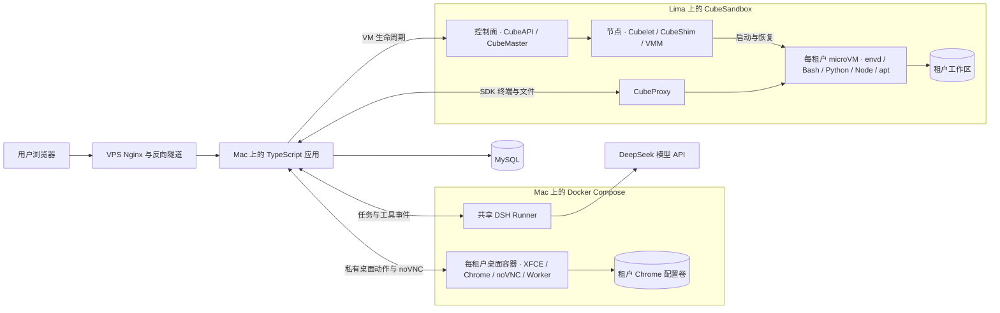

# DSH 和云桌面用 Docker，租户命令在 Cube microVM 执行

2026-11-27 · Coke Super Agent 架构调研

## 建议

**可以把 DSH 和云桌面一起部署在 Mac 的 Docker 里。** 建议用同一个 Compose 项目，运行一个 DSH Runner，以及每个租户各自的桌面容器。XFCE、可见的 Chrome、noVNC 和处理浏览器或键鼠操作的 Worker 在同一个桌面容器中。每个租户仍有一台 Cube microVM，负责 Bash、任务代码、Python、Node、apt 和持久工作区。Alice 与 Bob 两个测试账号共用一个 Runner，各用自己的桌面容器、Chrome 配置卷和 VM。

**同一容器也能跑 DSH 和桌面。** 单租户演示可以这样做。多租户版本建议分成上述两个角色，因为 DSH 持有模型凭据，而桌面处理网页、键鼠输入和租户的登录态。分开后，重启 DSH 可以保留用户眼前的 Chrome 会话。用 Compose 一次部署这些容器，无需 K3D。沿用 Coke Dots 风格的任务、活动和云电脑页面，现有 TypeScript 应用负责任务、鉴权和工具分发。

这个取舍有本机对照。11 月 25 日在同一台 Lima 节点，用相同 ARM64 镜像、Chrome 158、2 vCPU 和 2 GiB 内存测试离线页面。Docker 约 1 秒输出了预期 HTML，Cube guest 在 35 秒截止时仍无 HTML。旧版公网任务也记录过 CDP 连接被拒绝、X11 截图失败而 Bash 成功。对照支持把图形路径移到 Docker。具体的 guest 内核或虚拟化成因仍待定位，Docker 上完整的可见桌面和新 DSH 链路也有待实测。 [同机对照及原始日志索引](template-build-incident-2026-11-21.md#2026-11-25-same-lima-docker-control-and-profile-scoped-chrome-process-sample) · [公网任务检查点](checkpoints/checkpoint-2026-11-27.1.md)

## DeepSeek 有没有原生远程 Bash

有。当前项目固定 DSH `0.2.2-rc.2`，对应官方源码 `ddac967`。需分别看**供工具使用的执行接口**、**远程后端**和**本项目的默认 profile**。 [当前锁定版本](../scripts/cube/dsh-runtime/package.json) · [上游能力接口](https://github.com/deepseek-ai/deepseek-harness/blob/ddac96760b6edf8fa0fe17cbdcf0b512f4c12b2c/docs/capability-seams.md)

| 接法 | 已核实的行为 | 本项目取舍 |
| --- | --- | --- |
| SSH 后端 | 上游有 `ssh`、`subprocess-ssh`、`fs-ssh` 和 `sandbox-ssh`。命令、文件和沙箱策略可落到同一个远程 SSH 环境，后端使用已认证的 SSH 连接及其远端 helper。 | 有现成且受控的租户 SSH 环境时可以用。当前 Cube 已提供 envd，首版走 SDK 可以省去为每台 VM 建 SSH 服务、配发密钥和做连接维护。 |
| 自定义 `ctx.shell` 执行器 | 普通单次 `tool-bash` 依赖 `ctx.shell`。可实现自己的执行器接远端，保留原来的工具名和结果交互。需实现请求解析、输出、取消、作业等执行器语义。`ctx.sandbox` 的包装接口属于另一层，单换它不会把本地进程传送到远端。 | 等默认 Bash 工具或长期作业兼容成为需求后再评估。当前 `sdk-minimal` 的持久 Bash 走 `terminal-bash`、`ctx.terminals` 和本地子进程，单换 `ctx.shell` 覆盖不到这条路径。 |
| 自定义 DSH 工具加 Cube SDK | Cordis 插件可以通过 `ctx.tools.register()` 注册工具，TypeScript SDK 可用 `patches` 在启动时载入可信配置。工具回调只提交结构化请求和接收结果。 | **首选。** 关闭本地 Bash 和其他本地工具，注册 `computer_terminal`。现有应用调用 `sandbox.commands.run()`，保持 Cube 凭据和租户选择由应用持有。 |
| 旧 E2B 后端 | DSH 上游曾有 E2B 远程执行包，提交 `c49db8b` 已将其移除。项目固定的 rc.2 源码不包含该后端。 | Cube 提供 E2B 兼容 API，当前版本仍需接一层。无需回退 DSH，使用项目已依赖的 `@cubesandbox/sdk@0.8.0`。 |

[SSH 远程执行包](https://github.com/deepseek-ai/deepseek-harness/blob/ddac96760b6edf8fa0fe17cbdcf0b512f4c12b2c/packages/ssh/README.md) · [Shell 执行接口](https://github.com/deepseek-ai/deepseek-harness/blob/ddac96760b6edf8fa0fe17cbdcf0b512f4c12b2c/packages/shell/shell/README.md) · [工具注册手册](https://github.com/deepseek-ai/deepseek-harness/blob/ddac96760b6edf8fa0fe17cbdcf0b512f4c12b2c/docs/cookbook/adding-a-tool.md) · [SDK 配置类型](https://github.com/deepseek-ai/deepseek-harness/blob/ddac96760b6edf8fa0fe17cbdcf0b512f4c12b2c/packages/sdk/client/src/types.ts#L25-L48) · [E2B 后端移除记录](https://github.com/deepseek-ai/deepseek-harness/commit/c49db8bc8c2924e115308692d34af7539288e7bb)

### 如何让 DSH 只做大脑

`sdk-minimal` 自带 `bash`、`read_image` 和 `working_directory`。在固定版本的 Cordis 配置里，本地 Bash 的工具行 ID 是 **`persistent-bash`**，包名才是 `dsh-tool-bash-persistent`。首版应明确禁用 `persistent-bash`、`terminal-bash`、`tool-fs` 和 `tool-working-directory` 等模型可触达的本地路径，关闭 PowerShell 对应项，保持 SDK 服务、模型、会话存储和可信图片附件组件。通过实际启动后的工具清单验证生效，不能只检查 YAML 拼写。换装更完整的 profile 时仍要检查 hooks、插件安装、可执行 MCP、代码执行和子 Agent 等入口。 [固定版本 profile](https://github.com/deepseek-ai/deepseek-harness/blob/ddac96760b6edf8fa0fe17cbdcf0b512f4c12b2c/packages/bundle/sdk-minimal/cordis.patch.yml) · [官方工具注册与限制](https://github.com/deepseek-ai/deepseek-harness/blob/ddac96760b6edf8fa0fe17cbdcf0b512f4c12b2c/packages/core/tools/README.md#restrict-tools-per-agent)

DSH 只加载镜像内由项目维护的插件和配置。模型看到的是约定的远程工具。返回的文件、网页和终端内容进入模型时仍是任务数据，不能改变工具、目标或权限。插件配置和授权信号来自服务端。SDK 仍会启动可信的 DSH 进程并读写自己的会话，所以安全目标是**模型没有容器本地执行入口**，无需依赖容器镜像里恰好缺少 `/bin/bash`。`danger-full-access` 是执行权限模式，关闭本地工具要靠实际插件配置和运行验证。 [现有 runtime 启动路径](../scripts/cube/dsh-runtime/run-task.mjs) · [上游执行管线](https://github.com/deepseek-ai/deepseek-harness/blob/ddac96760b6edf8fa0fe17cbdcf0b512f4c12b2c/docs/tool-execution-pipeline.md)

## 最小部署

- **Mac 应用和公网入口。** VPS Nginx 经现有反向隧道转发到同一个产品入口。Mac 上的 TypeScript 应用查 MySQL 得到任务归属，在应用进程内把工具分发给相应的桌面或 Cube。对两个测试账号，Compose 可以预定义桌面，应用按租户映射到固定的私有端点。现有网页的桌面 HTTP/WebSocket 鉴权入口可以复用，后端的 `desktopTarget()` 目前用 CubeProxy 和 `sandbox.getHost(6080)`，需要改为选择 Docker 桌面并使用桌面自己的鉴权。 [桌面代理](../src/server/desktop-proxy.ts) · [租户 VM 对接](../src/server/computer.ts)
- **Docker 中的 DSH。** 一个可信 Runner 持有模型凭据，会话按 `tenantId/threadId` 持久化。应用经只绑定 Mac 回环地址的私有连接派发任务并接回工具请求。Runner 使用非 root 用户、只读根文件系统及独立会话卷。DSH 只注册任务工具，容器里的本地 shell 不向模型提供。模型和 Runner 均拿不到 Cube 管理凭据或 Docker Socket。共享 Runner 的应用级会话隔离需用两个租户验证。 [DSH 启动代码](../scripts/cube/dsh-runtime/run-task.mjs) · [Docker Engine 安全边界](https://docs.docker.com/engine/security/)
- **Docker 中的租户桌面。** 每个租户的容器从同一镜像启动，构建时预装 XFCE、Chrome、noVNC 和 Worker，持久卷保存该租户的 Chrome profile。Browser Use 操作桌面上可见的 Chrome，Computer Use 操作同一个 X11 显示，用户通过 noVNC 看见并接管这块屏幕。Worker 在容器内访问 CDP 和 X11，应用只接受约定的动作。每个桌面独立组网，应用通过私有端点访问，桌面无法直接访问其他租户、Runner 或 Cube 管理面。应在 PoC 验证这条网络边界，Compose 默认网络会让服务互通。 [可复用的 Grok 桌面 Worker](https://github.com/cokepoppy/coke-grok-bot/blob/35a134370e95667b1afc78509bf2ff582716bff7/deploy/desktop/computer-worker.mjs) · [Compose 网络](https://docs.docker.com/compose/how-tos/networking/)
- **Cube 控制面和租户 VM。** 应用通过 CubeAPI 请求创建、暂停或恢复，CubeMaster 调度，Lima 节点的 Cubelet、CubeShim 和 VMM 管理 VM。实际终端与文件请求由应用经 SDK、CubeProxy 到对应 VM 的 envd。VM 模板预装 Bash、Python、Node 和 apt，持久化该租户的 `/workspace`。第一个 PoC 可以复用受控测试 VM 的 envd，只启动执行所需组件，省去一次桌面模板构建。这个设计沿用 Cube 现有接口，无需单独的 Bash HTTP 服务或 SSH 端口。 [Cube 架构](https://github.com/TencentCloud/CubeSandbox/blob/v0.8.0/docs/architecture/overview.md) · [SDK 命令](https://github.com/TencentCloud/CubeSandbox/blob/v0.8.0/sdk/node/src/commands.ts) · [工作区初始化](../src/server/tenant-workspace.ts)

### 远程工具如何运行

1. **调度。** 现有实现会先启动租户 VM，再经 guest PTY 启动 DSH。迁移后，应用把登录租户、`threadId`、`runId` 绑定到任务，直接派发给 Docker Runner，再按工具调用查找目标。模型只提供命令、页面动作或任务文件引用，服务端决定目标和执行账号。纯终端任务只探测 envd，纯浏览器任务只探测桌面和浏览器。桌面就绪应验证可见的 X11、noVNC 和实际 CDP 请求，启动标记只作诊断线索。 [现有任务入口](../src/server/agent-runtime.ts#L171-L189) · [guest PTY 启动](../src/server/agent-runtime.ts#L317-L339)
2. **终端。** `computer_terminal` 经应用调用 `sandbox.commands.run(command, { user, cwd, timeoutMs, envs })`，记录 guest 的 stdout、stderr 和退出码。SDK 默认使用 root，日常命令显式使用模板中的普通任务账号，工作目录从 `/workspace/tasks/<threadId>` 开始。一次调用一个新 shell，后续命令可读回工作区的文件。产品里的交互式「终端」用应用鉴权的 Cube PTY 连接到同一 VM，`cd`、长进程及交互输入可在该 PTY 中继续。工具设定时限和有界输出，断线先核对执行状态再决定是否重试，避免重复执行已经产生副作用的命令。 [SDK 命令](https://github.com/TencentCloud/CubeSandbox/blob/v0.8.0/sdk/node/src/commands.ts) · [SDK 交互终端](https://github.com/TencentCloud/CubeSandbox/blob/v0.8.0/sdk/node/README.md#pty-interactive-terminal)
3. **浏览器和桌面。** 保留 `computer_browser`、`computer_desktop` 的工具契约。DSH 插件将动作交给应用，租户桌面的 Worker 访问本容器内的 CDP、截图和 X11。现有插件直接连接 `127.0.0.1:9222` 和本地显示，必须把工具注册与这些操作拆开。每个桌面同一时刻只有一个输入方。常规操作按任务直接执行，遇到真实登录或验证码，用户在原页面接管同一桌面。接管期间 Worker 暂停 Agent 的输入、读取页面和截图，归还后重新检查当前标签页再继续。 [现有电脑插件](../scripts/cube/dsh-runtime/computer-plugin.mjs) · [Grok Bot 接管与动作分发](https://github.com/cokepoppy/coke-grok-bot/blob/35a134370e95667b1afc78509bf2ff582716bff7/deploy/desktop/dsh-computer-plugin.mjs#L125-L158)
4. **调试。** 从页面发起、DSH 启动、首个模型事件到工具调用和回写，共用 `runId`、`toolCallId`。终端事件附 VM ID、generation、envd 耗时和退出码。桌面事件附桌面实例、CDP 或 X11 动作、耗时和结果。文件传递记录方向、大小和校验结果。前端调试模式突出第一个失败阶段和错误，区分「Chrome 渲染超时」「桌面未就绪」「Cube 命令失败」和「模型响应超时」。接管输入、会话 cookie、模型与 Cube 密钥都不记入日志。

### 两个文件系统如何协作

任务文件以 VM 中的 `/workspace/tasks/<threadId>` 为准。产品页面可继续使用现有的鉴权产物接口预览、下载 VM 中的 HTML。用户打开俄罗斯方块预览时，网页直接读取任务产物，这一步无需启动租户的云桌面。桌面 Chrome 的登录态保存在自己的卷，重启 Runner 或暂停 VM 均无需复制 profile。 [现有产物路由](../src/server/http.ts#L301-L370) · [产物路径校验](../src/server/artifacts.ts)

只有需要**用租户的 Chrome 打开或上传某个任务文件**时，应用才按租户和任务把选中的文件复制到该桌面的临时目录。反向操作同理，浏览器下载完成后，Worker 把选中的下载经应用导入同一任务的 VM 工作区。双向传递是新增能力。应用使用服务端生成的文件标识，校验归属、大小、普通文件类型及路径边界，拒绝越界或符号链接替换。传完校验内容再提交，重试按同一传输 ID 去重，临时副本按配额清理。Runner 和桌面均不挂载 VM 的整个工作区，VM 也不挂载浏览器卷。

## 安全评估

| 用户关心的问题 | 结论与边界 |
| --- | --- |
| DSH 的命令可以到哪里 | 支持的任意 Bash、Python、Node 与构建操作都由应用路由到租户 VM，Cube 暂不可用时返回工具错误。Runner 只运行可信的 DSH 与插件进程。验证时既要检查实际工具清单，也要确认命令运行的 UID、工作目录和写入的文件来自目标 guest。 |
| VM 与宿主、浏览器之间是什么边界 | VM 有独立 Linux 内核，工作区是节点上该租户的可写挂载。隔离还依赖 VMM、挂载、网络及凭据配置。Chrome profile 是独立的 Docker 卷，guest 命令无法经本机文件路径读取它。Cube 管理面、envd、CDP、VNC 与 Worker 都保持私有，产品入口代理只向已鉴权的所属租户提供桌面。 |
| 桌面键鼠能否变成本地执行 | 完整 XFCE 交互可能启动桌面容器内的程序。只关闭 DSH 的 Bash 工具无法覆盖这条路径。把桌面作为可被租户控制的环境，使用非 root 桌面账号、Chrome 自身沙箱、独立卷与网络，隔开模型密钥、管理端口、宿主目录和 Docker Socket。产品终端连接 Cube PTY，桌面会话中移除本地终端和命令启动入口。保留完整键鼠时，仍应按桌面容器内可能发生代码执行来设计，并实测它访问不到 Runner、宿主和其他租户。 |
| 如何保留 apt 和无打扰操作 | Bash、浏览和键鼠按当前任务执行，只有网站登录或验证码交回给用户。常用运行环境在镜像构建时预装。需要额外系统包时，在该租户 VM 内用 guest 管理权限运行 apt，软件包安装脚本也拥有该 VM 的管理权限。桌面容器使用预装镜像，模型凭据仅在 Runner 中。 |

旧桌面镜像给桌面账号配置了 `NOPASSWD:ALL`，旧启动脚本默认传 `--no-sandbox`。移植可复用软件安装层，Docker 桌面的启动方式需单独验证非 root 和 Chrome 沙箱有效。两个 Docker 桌面和 guest 都需要正常网页出站，验证时还要分别检查宿主服务、管理网和其他租户端点的可达性。Cube 的 `allowPublicTraffic: false` 约束 guest 入站，Docker 的网络和公网代理另行验证。 [Docker Engine 安全](https://docs.docker.com/engine/security/) · [Cube 网络策略](https://github.com/TencentCloud/CubeSandbox/blob/v0.8.0/docs/guide/network-policy.md) · [旧镜像用户设置](../images/coke-super-agent-desktop/Dockerfile#L75-L87) · [旧 Chrome 启动参数](../scripts/cube/csa-desktop-session.sh#L730-L755)

## Coke Grok Bot 能复用什么

已检查本机 Grok Bot 提交 `35a134370e95667b1afc78509bf2ff582716bff7`。`splitDesktopResources()` 确实生成独立的 `desktop` 与 `agent` Deployment 和 Service，以及各自的 NetworkPolicy。DSH 插件通过内部 HTTPS Bridge 调用 Browser、Computer 工具，并检查运行授权和用户是否接管。已有 Cordis patch 禁用多类默认工具，也有持久截图、字段规约和日志脱敏可复用。 [拆分部署](https://github.com/cokepoppy/coke-grok-bot/blob/35a134370e95667b1afc78509bf2ff582716bff7/src/server/desktop-resources.ts#L80-L110) · [电脑桥接](https://github.com/cokepoppy/coke-grok-bot/blob/35a134370e95667b1afc78509bf2ff582716bff7/deploy/desktop/dsh-computer-plugin.mjs#L125-L158) · [DSH patch](https://github.com/cokepoppy/coke-grok-bot/blob/35a134370e95667b1afc78509bf2ff582716bff7/deploy/desktop/cloud-kernel-adapter.mjs#L997-L1009)

Grok Bot 的 `computer_terminal` 调用 `runTaskTerminal()`，后者在 Agent 进程所在环境直接 spawn Bash，并使用 Agent 与 Desktop 共享的 PVC。可以复用工具契约、输出限制、接管检查和故障分类。Coke Super Agent 的实际 Bash 改由应用调用 Cube，同样的插件名不能代替执行位置的验证。Grok Bot 的 patch ID 也需要按本项目的 DSH 版本重新核对。DeepSeek 的 Super Agent 原型适合参考 Router 和 Worker 职责划分，它的 Worker 仍以部署者的 OS 用户执行命令。 [Grok Bot 终端工具](https://github.com/cokepoppy/coke-grok-bot/blob/35a134370e95667b1afc78509bf2ff582716bff7/deploy/desktop/dsh-computer-plugin.mjs#L87-L103) · [本地 Bash 实现](https://github.com/cokepoppy/coke-grok-bot/blob/35a134370e95667b1afc78509bf2ff582716bff7/deploy/desktop/computer-tools.mjs#L39-L71) · [DeepSeek 原型执行设计](https://github.com/deepseek-ai/dsh-superagent-prototype/blob/8c32a9dc5d72c033816c6a8110b37f40cf94fba4/docs/003-execution.md)

## PoC 与通过标准

| 阶段 | 验收时要取得的证据 |
| --- | --- |
| 1. 先验证 Docker 桌面 | 在目标 Mac Docker 环境启动一个预装桌面，打开本地测试页。记录 X11、noVNC、CDP 首次成功及可见页面呈现的耗时。由公网产品页看到同一 Chrome，Browser Use 点击改变页面状态，Computer Use 确认可见变化，用户接管并归还后 Agent 读到原标签的状态。此项可在 Cube guest 的图形组件全部停用时独立通过。 |
| 2. 验证 DSH 调用 Cube Bash | 让 Docker 中的真实 DSH 通过 `computer_terminal` 在 VM 写入唯一标记，另一次调用读回，核对 UID、目录、输出和退出码。核对启动后的工具清单，确认本地 Bash 无法调用。桌面停用时同一终端任务仍能成功，Cube 不可用时应返回明确的 Cube 工具错误。记录首个模型事件与 envd 往返耗时。 |
| 3. 打通文件与整条任务 | Alice 从公网网页发起新任务，生成单文件 HTML 俄罗斯方块。以任务实际 `done`、从 VM 预览成功，以及点击移动、旋转、硬降、暂停、重开产生可见变化为通过条件。另让桌面 Chrome 通过文件传递打开这份 HTML，验证一次向测试页面上传和一次将浏览器下载导入 VM，核对两端的文件校验值及任务归属。 |
| 4. 两个租户与重启 | Alice 和 Bob 各用自己的 VM、桌面和 Chrome profile。用合成标记验证无法跨租户访问终端、产物、下载、桌面 HTTP/WebSocket、登录态或管理服务。分别重启 Runner、桌面容器、VM 和应用，验证 Chrome 配置、VM 文件、任务和会话按各自的持久化位置恢复。用同一任务的前端时间线核对失败阶段以及未重复执行的副作用，记录 Mac 内存和磁盘余量。 |

PoC 先用新任务、空的桌面测试卷和仅含合成数据的 guest 工作区。旧版将桌面 home 放在 `/workspace/.desktop-home`，直接沿用原工作区会让 guest 命令仍可能读到旧登录态。迁移已有数据时，保留原卷作回退，给新执行环境只导入所需任务文件。旧 Chrome profile 用同版本副本在租户桌面验证，旧 DSH JSONL、附件及目录映射在 Runner 验证。桌面镜像放本地 registry，两个租户复用镜像层，分别计量卷、容器可写层和日志占用。 [旧工作区与 home 配置](../src/server/agent-runtime.ts#L326-L339)

本文是从 `checkpoint-2026-11-27.1`（`077e4a1`）出发的调研设计。目前有固定版本源码、既有项目实现和离线渲染对照可查，上表是新部署待完成的验收项。
