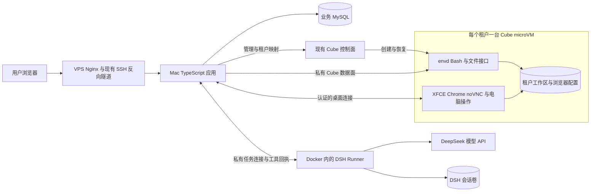

# DSH 用 Docker，Bash 用 Cube microVM

2026-11-27 · Coke Super Agent 架构调研

## 建议

**方案可行，建议先做一个非交互远程 Bash 的 PoC。** Mac 上的 Docker 容器运行 DSH，负责模型调用、工具选择和会话。现有 TypeScript 应用按任务归属调用 CubeSandbox SDK，在对应租户的 microVM 内执行 Bash。XFCE、Chrome、noVNC 和租户文件继续放在同一台 microVM，Agent 和用户操作同一个浏览器配置和画面。业务部署用 Docker 和现有 Cube 单节点即可。

关闭本地工具并验证后，所有模型发起的 Bash 都经应用送到租户 VM。DSH 的启动和运行负担也会移出 Cube guest，速度收益要靠对照实测。MicroVM 的独立内核能加强隔离，实际安全仍取决于虚拟机、挂载、网络、凭据与执行接口的配置。脚本可以操作其执行账号有权访问的文件与浏览器会话。

## DeepSeek 有没有原生远程 Bash

有。当前项目固定 DSH `0.2.2-rc.2`，对应官方源码 `ddac967`。需分别看**供工具使用的执行接口**、**远程后端**和**本项目的默认 profile**。 [当前锁定版本](../scripts/cube/dsh-runtime/package.json) · [上游能力接口](https://github.com/deepseek-ai/deepseek-harness/blob/ddac96760b6edf8fa0fe17cbdcf0b512f4c12b2c/docs/capability-seams.md)

| 接法 | 已核实的行为 | 本项目取舍 |
| --- | --- | --- |
| SSH 后端 | 上游有 `ssh`、`subprocess-ssh`、`fs-ssh` 和 `sandbox-ssh`。命令、文件和沙箱策略可落到同一个远程 SSH 环境，后端使用已认证的 SSH 连接及其远端 helper。 | 有现成且受控的租户 SSH 环境时可以用。当前 Cube 已提供 envd，首版走 SDK 可以省去为每台 VM 建 SSH 服务、配发密钥和做连接维护。 |
| 自定义 `ctx.shell` 执行器 | 普通单次 `tool-bash` 依赖 `ctx.shell`。可实现自己的执行器接远端，保留原来的工具名和结果交互。需实现请求解析、输出、取消、作业等执行器语义。`ctx.sandbox` 的包装接口属于另一层，单换它不会把本地进程传送到远端。 | 等默认 Bash 工具或长期作业兼容成为需求后再评估。当前 `sdk-minimal` 的持久 Bash 走 `terminal-bash`、`ctx.terminals` 和本地子进程，单换 `ctx.shell` 覆盖不到这条路径。 |
| 自定义 DSH 工具加 Cube SDK | Cordis 插件可以通过 `ctx.tools.register()` 注册工具，TypeScript SDK 可用 `patches` 在启动时载入可信配置。工具回调只提交结构化请求和接收结果。 | **首选。** 关闭本地 Bash 和其他本地工具，注册 `computer_terminal`。现有应用调用 `sandbox.commands.run()`，保持 Cube 凭据和租户选择由应用持有。 |
| 旧 E2B 后端 | DSH 上游曾有 E2B 远程执行包，提交 `c49db8b` 已将其移除。项目固定的 rc.2 源码不包含该后端。 | Cube 提供 E2B 兼容 API，当前版本仍需接一层。无需回退 DSH，使用项目已依赖的 `@cubesandbox/sdk@0.8.0`。 |

[SSH 远程执行包](https://github.com/deepseek-ai/deepseek-harness/blob/ddac96760b6edf8fa0fe17cbdcf0b512f4c12b2c/packages/ssh/README.md) · [Shell 执行接口](https://github.com/deepseek-ai/deepseek-harness/blob/ddac96760b6edf8fa0fe17cbdcf0b512f4c12b2c/packages/shell/shell/README.md) · [工具注册手册](https://github.com/deepseek-ai/deepseek-harness/blob/ddac96760b6edf8fa0fe17cbdcf0b512f4c12b2c/docs/cookbook/adding-a-tool.md) · [SDK 配置类型](https://github.com/deepseek-ai/deepseek-harness/blob/ddac96760b6edf8fa0fe17cbdcf0b512f4c12b2c/packages/sdk/client/src/types.ts#L25-L48) · [E2B 后端移除记录](https://github.com/deepseek-ai/deepseek-harness/commit/c49db8bc8c2924e115308692d34af7539288e7bb)

### 如何让 DSH 只做大脑

`sdk-minimal` 自带 `bash`、`read_image` 和 `working_directory`。在固定版本的 Cordis 配置里，本地 Bash 的工具行 ID 是 **`persistent-bash`**，包名才是 `dsh-tool-bash-persistent`。首版应明确禁用 `persistent-bash`、`terminal-bash`、`tool-fs` 和 `tool-working-directory` 等模型可触达的本地路径，关闭 PowerShell 对应项，保持 SDK 服务、模型、会话存储和可信图片附件组件。通过实际启动后的工具清单验证生效，不能只检查 YAML 拼写。换装更完整的 profile 时仍要检查 hooks、插件安装、可执行 MCP、代码执行和子 Agent 等入口。 [固定版本 profile](https://github.com/deepseek-ai/deepseek-harness/blob/ddac96760b6edf8fa0fe17cbdcf0b512f4c12b2c/packages/bundle/sdk-minimal/cordis.patch.yml) · [官方工具注册与限制](https://github.com/deepseek-ai/deepseek-harness/blob/ddac96760b6edf8fa0fe17cbdcf0b512f4c12b2c/packages/core/tools/README.md#restrict-tools-per-agent)

DSH 只加载镜像内由项目维护的插件和配置。模型看到的是约定的远程工具。返回的文件、网页和终端内容进入模型时仍是任务数据，不能改变工具、目标或权限。插件配置和授权信号来自服务端。SDK 仍会启动可信的 DSH 进程并读写自己的会话，所以安全目标是**模型没有容器本地执行入口**，无需依赖容器镜像里恰好缺少 `/bin/bash`。`danger-full-access` 是执行权限模式，关闭本地工具要靠实际插件配置和运行验证。 [现有 runtime 启动路径](../scripts/cube/dsh-runtime/run-task.mjs) · [上游执行管线](https://github.com/deepseek-ai/deepseek-harness/blob/ddac96760b6edf8fa0fe17cbdcf0b512f4c12b2c/docs/tool-execution-pipeline.md)

## 最小部署

- **Mac 应用。** 保留任务调度、租户鉴权、调试时间线、产物路由和 Cube 控制面。把远程工具分发做成现有应用内的 TypeScript 模块。复用 `connectTenantSandbox()`、租户工作区和桌面代理。租户路径的现有初始化通过 Mac 上的 `limactl` 完成，放在这层最省迁移。 [租户 VM 对接](../src/server/computer.ts) · [工作区初始化](../src/server/tenant-workspace.ts) · [桌面代理](../src/server/desktop-proxy.ts)
- **Docker Runner。** 一个容器先跑两个合成租户的 DSH 任务，DSH 会话按 `tenantId/threadId` 单独持久化。Mac 应用主动连到只映射至 Mac 回环地址的 Runner 端口，使用一条私有双向连接传递任务、工具请求、结果和事件。Runner 用非 root 账号、只读根文件系统、最少的可写会话卷、默认 seccomp、`no-new-privileges` 和 CPU、内存、进程数限制。Runner 只取得模型凭据和当前任务能力，其网络访问按模型调用所需配置并实测。Docker Socket、Mac 目录、MySQL 管理凭据、Cube 管理凭据和租户 VM 的工作区都不交给 Runner。共享 Runner 是可信服务，若要隔离运行时本身失陷后的会话数据，再用每租户独立容器及独立卷验证。 [Docker Engine 安全边界](https://docs.docker.com/engine/security/) · [容器运行选项](https://docs.docker.com/reference/cli/docker/container/run/)
- **Cube microVM。** 一台租户 VM 提供工作区、Bash、Python、Node、apt、桌面和浏览器。CubeAPI 与 CubeMaster 接收管理请求并调度，Cubelet/CubeShim 在 Lima 节点启动和管理 guest。终端 PoC 使用模板已有的 envd，无需另写常驻 Bash HTTP 服务或开放 SSH。产品需要画面、键鼠和浏览器时，由同一台 VM 提供相应能力。VPS 只转发现有产品入口。 [Cube 架构](https://github.com/TencentCloud/CubeSandbox/blob/v0.8.0/docs/architecture/overview.md) · [Node SDK](https://github.com/TencentCloud/CubeSandbox/blob/v0.8.0/sdk/node/README.md#run-shell-commands) · [上游桌面示例](https://github.com/TencentCloud/CubeSandbox/blob/v0.8.0/examples/ubuntu-desktop/README.md)

### 远程工具如何运行

1. 用户从现有页面创建任务。应用按登录会话匹配 `tenantId`，用数据库记录绑定 `runId`、`threadId` 和 microVM `generation`，再向 Runner 派发当前任务。服务端根据这组绑定解析目标 VM 与目录。模型只传 `command` 等工具参数，无法指定 VM ID、运行账号、连接地址或凭据。
2. `computer_terminal` 通过私有连接提交命令。应用用 `@cubesandbox/sdk` 的 `sandbox.commands.run(command, { user, cwd, timeoutMs, envs })` 调用 envd，取得 stdout、stderr、退出码。SDK 默认以 root 执行，服务端必须显式指定模板预置的执行账号，并构造最小 env。工作目录固定为 `/workspace/tasks/<threadId>`，需要租户共享目录时用明确的选择项。`cwd` 只是起点，访问范围要由 guest 账号、挂载与网络实际隔离。 [SDK 命令实现及默认账号](https://github.com/TencentCloud/CubeSandbox/blob/v0.8.0/sdk/node/src/commands.ts)
3. 首版每次命令使用新 shell，文件在 VM 工作区持久化。`cd`、临时环境变量和交互进程的状态不会从一次调用继承到下一次。根据需要再用 `sandbox.pty.create/connect` 或一个受管 guest 作业实现交互终端、长命令、取消和输出续传。envd 的 `commands.run` 超时包含总时限。应用还要限制输出和资源，SDK 收集 stdout/stderr 时就应有上游边界。连接断开先核对 guest 是否已结束及是否有副作用，禁止自动重放结果不明确的命令。 [命令超时语义](https://github.com/TencentCloud/CubeSandbox/blob/v0.8.0/sdk/node/README.md#execute-code) · [PTY 接口](https://github.com/TencentCloud/CubeSandbox/blob/v0.8.0/sdk/node/README.md#pty-interactive-terminal)
4. 文件上传、读取和下载沿用现有租户任务路由。需要给模型看文件时走受控工具，校验所属任务、相对路径和符号链接，按执行账号读取。浏览器与桌面操作复用现有 `computer_browser` 和 `computer_desktop` 的动作与返回格式，将 CDP、截图、X11 操作移到 VM 内执行。PoC 可通过 SDK 调用固定 guest helper。以后如果每次调用开销太大，再在该 VM 保留一个私有 Worker。现有 DSH 插件直接访问本机 `127.0.0.1:9222` 和 X11，移进 Docker 时要拆开它的工具注册和实际执行。 [现有产物校验](../src/server/artifacts.ts) · [现有电脑插件](../scripts/cube/dsh-runtime/computer-plugin.mjs)
5. 登录或验证码继续交接到同一 noVNC 桌面。应用核对任务控制权，用户接管期间暂停 Agent 的电脑输入及可影响该桌面的命令，归还后重新读当前状态。日志串起 `runId → toolCallId → Cube VM/generation → guest 结果`，区分 DSH 启动、首个模型事件、VM 连接、guest 执行、输出与回写。调试页面展示阶段、耗时、错误和受控输出摘要，凭据和登录表单值留在各自边界内。

## 安全评估

| 用户关心的问题 | 结论与边界 |
| --- | --- |
| 在 Docker 里用 Bash 是否会提权到宿主 | 命令通常受容器用户、namespace 和权限约束。在 Mac Docker Desktop 上，共享 Linux 内核的是 Docker Desktop 的 Linux 环境。风险来自执行与主机权限之间的通路，例如过宽挂载、Docker 管理接口、特权容器或运行时漏洞。移除 DSH 可调用的本地执行入口能显著减少这个风险，进程与依赖仍需容器级隔离。 |
| 在 microVM 里 Bash 是否就安全 | 同一命令在独立 guest 内核里运行，正常拿到的权限只属于 guest。宿主保护还依赖 VMM/KVM、Cube 控制和数据面、设备、宿主挂载及网络配置。当前租户 `/workspace` 是 Cube 节点上租户专用目录的可写挂载，其内容需要视为 guest 可控。私有 token 和鉴权由应用持有，Cube 管理面、envd、CDP 和 Bash 接口保持私有。 |
| 命令能否读取已登录 Chrome 的数据 | 当前镜像给桌面账号 `NOPASSWD:ALL`，Chrome 启动脚本默认可加 `--no-sandbox`。给命令传当前桌面 UID，不能证明 Chrome profile 隔离。新方案的命令用独立、无 sudo 的 guest 账号，浏览器 profile 用桌面账号私有权限，X11/CDP 的访问也要隔开。仅把 CDP 绑定到 guest 的 `127.0.0.1`，无法限制该 guest 中的其他进程。 |
| 原先允许 apt 和常规操作怎么保留 | 用户在自己的云桌面有需要时可以用 guest 管理权限安装包。Agent 日常 Bash、Browser Use 和 Computer Use 依当前任务直接执行，无逐步审批。若还要让 Agent 直接拿 guest root 执行 apt，就把整台 VM（含同 VM 的浏览器资料）视为该 Agent 的信任域。真正不受信任的任意脚本或包含敏感登录态的场景，可以用无登录数据的临时 VM 做额外分隔。 |

[Docker Engine 安全](https://docs.docker.com/engine/security/) · [Docker Desktop 网络](https://docs.docker.com/desktop/features/networking/) · [Cube 网络策略](https://github.com/TencentCloud/CubeSandbox/blob/v0.8.0/docs/guide/network-policy.md) · [当前镜像用户设置](../images/coke-super-agent-desktop/Dockerfile#L75-L87) · [Chrome 启动策略](../scripts/cube/csa-desktop-session.sh#L730-L755)

租户边界由应用会话、运行授权、Cube 沙箱绑定、每租户磁盘和网络共同落实。Guest 公网出站可以保留，同时控制面、宿主和其他租户的私网继续限制。网络检查需要实测。`allowPublicTraffic: false` 管的是访问 guest 服务的入站路径，不能替代出站隔离。模型调用所需的 key 只留在 Docker 侧。 [当前沙箱创建策略](../src/server/computer.ts#L301-L329) · [Cube 网络策略](https://github.com/TencentCloud/CubeSandbox/blob/v0.8.0/docs/guide/network-policy.md)

## Coke Grok Bot 能复用什么

已检查本机 Grok Bot 提交 `35a134370e95667b1afc78509bf2ff582716bff7`。`splitDesktopResources()` 确实生成独立的 `desktop` 与 `agent` Deployment 和 Service，以及各自的 NetworkPolicy。DSH 插件通过内部 HTTPS Bridge 调用 Browser、Computer 工具，并检查运行授权和用户是否接管。已有 Cordis patch 禁用多类默认工具，也有持久截图、字段规约和日志脱敏可复用。 [拆分部署](https://github.com/cokepoppy/coke-grok-bot/blob/35a134370e95667b1afc78509bf2ff582716bff7/src/server/desktop-resources.ts#L80-L110) · [电脑桥接](https://github.com/cokepoppy/coke-grok-bot/blob/35a134370e95667b1afc78509bf2ff582716bff7/deploy/desktop/dsh-computer-plugin.mjs#L125-L158) · [DSH patch](https://github.com/cokepoppy/coke-grok-bot/blob/35a134370e95667b1afc78509bf2ff582716bff7/deploy/desktop/cloud-kernel-adapter.mjs#L997-L1009)

Grok Bot 的 `computer_terminal` 调用 `runTaskTerminal()`，后者在 Agent 进程所在环境直接 spawn Bash，并使用 Agent 与 Desktop 共享的 PVC。可以复用工具契约、输出限制、接管检查和故障分类。Coke Super Agent 的实际 Bash 改由应用调用 Cube，同样的插件名不能代替执行位置的验证。Grok Bot 的 patch ID 也需要按本项目的 DSH 版本重新核对。DeepSeek 的 Super Agent 原型适合参考 Router 和 Worker 职责划分，它的 Worker 仍以部署者的 OS 用户执行命令。 [Grok Bot 终端工具](https://github.com/cokepoppy/coke-grok-bot/blob/35a134370e95667b1afc78509bf2ff582716bff7/deploy/desktop/dsh-computer-plugin.mjs#L87-L103) · [本地 Bash 实现](https://github.com/cokepoppy/coke-grok-bot/blob/35a134370e95667b1afc78509bf2ff582716bff7/deploy/desktop/computer-tools.mjs#L39-L71) · [DeepSeek 原型执行设计](https://github.com/deepseek-ai/dsh-superagent-prototype/blob/8c32a9dc5d72c033816c6a8110b37f40cf94fba4/docs/003-execution.md)

## 桌面和 Chrome 放哪里

| 部署 | 评估 |
| --- | --- |
| **DSH 在 Docker，Chrome 和桌面在租户 microVM** | 推荐。租户文件、浏览器 profile、noVNC 画面和用户接管都位于同一台电脑。DSH 可以独立重启。需要单独验证 Chrome 在本机 Cube guest 的启动和 CDP 表现。 |
| DSH 和桌面在同一个 Docker 容器，Bash 在 microVM | 进程、桌面输入和模型运行时处在同一个容器。浏览器与终端分在两个文件系统，文件上传、下载和浏览器状态要额外同步。共享场景下还会增加 DSH 凭据和浏览器登录态之间的风险。 |
| DSH 在 Docker，另有每租户 Docker 桌面，Bash 在 microVM | 可作为本机测试 Chrome 性能的对照。会为每租户增加一套环境、存储和接管路径，桌面因此只有容器隔离。 |
| DSH 和桌面都在 microVM | 现有分支方案。共享本地文件和桌面方便。DSH 初始化、模型调用处理和 Chrome 会争用 guest 资源，且此前旧 VM 有运行包传输开销。 |

历史排障已经用同一 ARM64 镜像做过对照。在同一 Lima 节点的 Docker 内，Chrome 在 2 vCPU、2 GiB 条件下约一秒渲染离线页面。Cube guest 的同类验证仍有渲染和 CDP 超时。把 DSH 移出 guest 有机会减少负载，Chrome 仍需单独验证。终端任务只依赖 VM 和 envd 就绪，Browser/Computer 工具按需探测自己的 X11、noVNC 或 CDP。分别记录 DSH 首次响应、Cube SDK Bash 往返、X11/noVNC 就绪和 Chrome CDP 命令耗时。Mac 上 Docker Desktop 和 Lima 也会各自占用宿主资源。 [同一节点 A/B 记录](template-build-incident-2026-11-21.md#2026-11-25-same-lima-docker-control-and-profile-scoped-chrome-process-sample) · [已存检查点](checkpoints/checkpoint-2026-11-27.1.md)

## PoC 与通过标准

| 阶段 | 实测证据 |
| --- | --- |
| 1. DSH 启动和远程 Bash | 使用同一版本和模型，核对有效工具清单，直接验证禁用的本地 Bash 名称无法分发。真实 DSH 任务通过 `computer_terminal` 在 VM 写入唯一标记，另一次调用读回。确认进程 UID、目录和退出码来自目标 VM。模拟 Cube 暂不可用时检查显式错误和本地无执行。先复用受控测试 guest，是否需要新建 VM 由容量与执行账号可用性决定。 |
| 2. 文件与租户隔离 | Alice 生成一个新名字的单文件 HTML 俄罗斯方块，任务结束状态为 `done`。从已登录公网网页预览并点击移动、旋转、硬降、暂停和重开。Bob 的任务无法选择或读到 Alice 的工作区或文件。用合成数据验证跨租户授权、失效运行租约、guest 执行账号、宿主目录及私有服务的边界。 |
| 3. 同屏桌面 | 单独验证 XFCE/X11、noVNC 和 Chrome CDP。Agent 使用 Browser Use 打开测试页，Computer Use 对可见桌面截图或操作，用户接管并归还后 Agent 读取同一页面和状态。用允许的测试页面和合成资料验证工具与登录资料的隔离。 |
| 4. 耐久性与性能 | 用相同 prompt、模型和 VM，分别记录 DSH 在 Docker 与原 guest 的启动、首工具和总耗时。重启 Runner、应用和 VM，核对同一任务记录、guest 文件、浏览器状态和恢复行为。持久化 DSH JSONL、任务与 tool call 状态分别对账，结果不明确的工具调用不重放。记录宿主内存和磁盘余量。 |

迁移时分开保存应用任务记录、Runner 会话和 VM 数据。现有 DSH 会话在 guest 内，PoC 使用新测试任务。若要延续旧对话，需要验证固定版本 JSONL、附件、会话 ID、工作目录映射和回退，再迁移。第一阶段通过即可确认分离架构能执行远程 Bash。Browser/Computer Use、跨租户和重启通过后，再把 Docker Runner 设为默认。

本轮完成了固定版本源码、SDK 类型和项目实现的核对。上述 Docker → Cube 链路和安全边界留待 PoC 实测。研究起点为 `checkpoint-2026-11-27.1`（`077e4a1`）。
