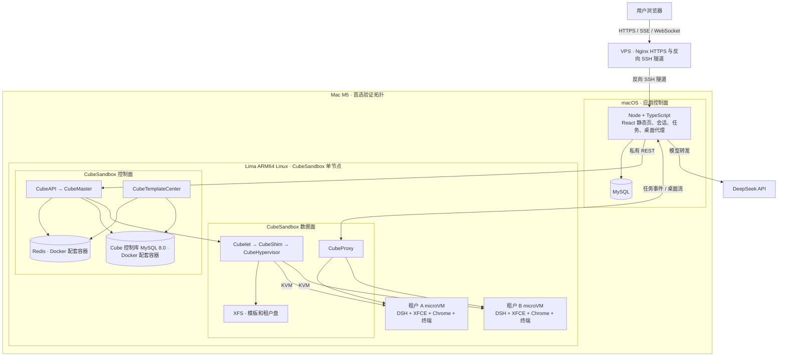

# Coke Super Agent 技术方案

2026-11-19 · 首版调研

## 首版决策

**一个 TypeScript 应用、一套业务 MySQL、一个 CubeSandbox 节点，每个个人租户一台 Linux microVM。** 同一台租户 VM 内运行 DeepSeek Harness、桌面、浏览器和终端。用户从 Coke Dots 风格的任务页发起工作、看进度、打开电脑和接管，刷新后可以重开任务及其结果。前端构建为静态文件，由 TypeScript 服务同源提供。

**Mac M5 已经跑通开发用的本地 Cube 数据面。** 2026-11-19 的实测在 Lima ARM64 Linux 中启动了 CubeSandbox v0.8.0 和一台真实 KVM microVM，并验证官方 SDK 的命令、文件和暂停恢复。该结果证明这台 Mac 可作为单节点开发数据面；XFCE/Chrome、宿主重启恢复和加密租户盘仍需验收，因此尚未作为存放真实租户数据的环境。实验用 24 GiB 限容卷保护 Mac 内盘；该卷未加密。 [实测记录](cube-preflight.md#2026-11-19-m5-本地单节点实测) · [Apple 虚拟化接口](https://developer.apple.com/documentation/virtualization/vzgenericplatformconfiguration/isnestedvirtualizationsupported) · [CubeSandbox 部署要求](https://docs.cubesandbox.com/guide/bare-metal-deploy)

**Browser Use、Computer Use 和租户内终端默认可用。** 常规导航、点击、输入、运行命令和安装系统包直接执行。站点要求登录、验证码或同类身份验证时，Agent 暂停并提示用户接管同一台电脑。账号、任务、文件、浏览器配置和桌面连接始终归属租户。

## 调研结论

### Dots 的产品交互与 DeepSeek 的执行架构

OpenAI dots 提供持续可用的个人 Agent、后台任务、独立云电脑和任务更新。Coke 首版沿用自有 Coke Dots 的任务时间线、活动与文件入口、电脑画面和接管交互，采用 Coke Super Agent 自有视觉。一个账户看到一个持续的 Agent，任务可独立打开、追问与查看进度。 [OpenAI dots 官方介绍](https://openai.com/index/introducing-dots/)

DeepSeek Harness 团队原文把工作拆为负责交互和派发的 Router、独立上下文的 Worker，并讨论了事件过滤与直通、异步交互、计算与状态分离、Watchdog。开源原型是面向单个 GitHub 仓库的 Harness 插件，可选飞书，用 SQLite 保存编排状态，每个 Ticket 有自己的 DSH Session 与目录。文章的设计范围覆盖更多场景，原型 README 说明了发布版本与内部实现的差异。Coke 借用职责划分和恢复机制，使用现有的个人 Agent UI 与 MySQL。 [DeepSeek Harness 团队微信原文](https://mp.weixin.qq.com/s/zoS7GlReWPhfCjENGxXCdg) · [原型 README](https://github.com/deepseek-ai/dsh-superagent-prototype/blob/8c32a9dc5d72c033816c6a8110b37f40cf94fba4/README.md) · [原型架构与持久化](https://github.com/deepseek-ai/dsh-superagent-prototype/blob/8c32a9dc5d72c033816c6a8110b37f40cf94fba4/docs/007-architecture.md)

| DeepSeek 设计 | Coke 首版实现 |
| --- | --- |
| Router | Node 进程内的 TypeScript 模块，接住用户请求、登记任务、推送进度、把显式跟进路由到对应任务。基于任务 ID 和用户动作判断归属。 |
| Worker | VM 内由一个 TypeScript 服务启动 DSH。每个任务有自己的 Harness Session、目录与执行记录。一个租户首版同时跑一条任务，共享一套真实鼠标键盘与浏览器。不同租户可并行。 |
| 异步交互、事件路由 | 提交立即拿到任务 ID，页面订阅已持久化的进度。首版输入是用户请求及其跟进、停止和接管事件。工作链路跑通后可增加用户明确配置的定时触发。 |
| 存算分离、Watchdog | MySQL 保留产品状态，租户盘保留真实环境。应用进程内的定时检查对账正在创建的 VM、失联的任务、未回写的结果。根据记录恢复，外部结果不明时记为待核实。 |

两层是逻辑职责。一期用代码实现 Router，DSH 负责实际执行和工具调用。长驻模型 Router、多信道连接器、复杂事件判断与并行操作同一桌面的能力留待后续用真实需求验证。Mac 睡眠或离线时本机执行会中断，恢复后依靠保存的状态继续使用。

### CubeSandbox 的单机形态

首版验证固定 `v0.8.0`（`41748bb`）。CubeAPI 提供 E2B 兼容的 HTTP API。CubeMaster 负责调度与生命周期。CubeTemplateCenter 管理模板构建。Cubelet 在计算节点通过 containerd 及 CubeShim 启动 CubeHypervisor。VMM 用 Linux KVM 给每台 microVM 启动独立内核。CubeCoW 基于 XFS reflink 管理本地写层和快照，CubeVS 负责网络隔离，CubeProxy 路由客体端口和桌面连接。单节点安装把这些组件放在同一个 Linux 节点，提供一套上游的管理与计算能力。 [架构文档](https://github.com/TencentCloud/CubeSandbox/blob/v0.8.0/docs/architecture/overview.md) · [KVM 实现](https://github.com/TencentCloud/CubeSandbox/blob/v0.8.0/hypervisor/hypervisor/src/kvm/mod.rs) · [v0.8.0 发布](https://github.com/TencentCloud/CubeSandbox/releases/tag/v0.8.0)

Cube v0.8.0 单机安装包把 MySQL、Redis（以及可选 MinIO）作为本机 Docker 容器，通过 systemd 管理；CubeProxy 和核心程序按安装包配置运行。它们是控制面/单机部署的配套服务。租户沙箱不是这些 Docker 容器：计算路径是 Cubelet 使用 containerd Shim v2 调用 CubeShim，再由 CubeHypervisor 通过 KVM 启动独立 microVM。本次 Ubuntu 的 Compose v1 兼容错误发生在配套服务容器启动处，给该访客机安装 Compose v2 后 Cube 单机 quickcheck 通过。Mac 上现有 Docker 配置没有改动。 [v0.8.0 单机安装说明](https://github.com/TencentCloud/CubeSandbox/blob/v0.8.0/deploy/one-click/README.md) · [上游架构](https://github.com/TencentCloud/CubeSandbox/blob/v0.8.0/docs/architecture/overview.md)

目标方案让 TS 应用使用现有 MySQL 的 `coke_super_agent` schema，并先验证 Cube 能否共用该服务中独立的 `cube_mvp` schema。本轮为保护现有 MySQL 未更改其配置，Cube 使用同一 Lima Linux 节点内由安装包管理的 MySQL 8.0 和 Redis。MySQL 8.4 外部连接、schema 初始化和认证兼容性仍待验证，再决定是否共用。首轮关闭随包 MinIO，用文件存储。 [单机依赖配置](https://github.com/TencentCloud/CubeSandbox/blob/v0.8.0/deploy/one-click/support/docker-compose.yaml.template)

## 部署拓扑

这里有两个逻辑控制面：Mac 上的 Coke TypeScript 服务管理用户、任务和租户到 VM 的归属；同一个 Lima Linux 节点内的 CubeAPI、CubeMaster、CubeTemplateCenter 管理 sandbox 生命周期和模板。节点内的 MySQL/Redis 由 Docker Compose 启动并由 systemd 管理。Cubelet、containerd Shim、CubeShim、CubeHypervisor 与 KVM 构成创建 microVM 的计算路径。两者不需要拆成多台机器或 Coke 微服务；验证外部库兼容性后，再决定是否共用 Mac 上已有的 MySQL 服务。

1. **Mac 路径。** 已按 `infra/lima/cube-node.yaml` 在独立限容卷创建 ARM64 Linux 节点，`vmType: vz`、`nestedVirtualization: true`，无宿主目录挂载。客体 `/dev/kvm` 探针和一台真实 CubeSandbox v0.8.0 microVM 均通过。PVM 快速安装路径仅面向 x86_64。 [本地节点配置与实测](cube-preflight.md#2026-11-19-m5-本地单节点实测) · [CubeSandbox ARM64 部署](https://docs.cubesandbox.com/guide/bare-metal-deploy#arm64-aarch64-hosts) · [上游 ARM64 说明](https://github.com/TencentCloud/CubeSandbox/blob/v0.8.0/hypervisor/docs/arm64.md)
2. **容量与备选。** 上游单机要求至少 8 GB RAM。本机总内存 16 GB，目前 Docker Linux 客体报告约 7.75 GiB 总内存。先跑一台轻量桌面，再实测两台同时工作时的可用内存、swap 和首帧延迟。租户初始规格以 2 vCPU、2 GiB RAM 为测试起点。若嵌套 KVM 无法完成 Cube 实例启动或并发资源不足，改用一台带可用 KVM 的独立 Linux 节点，应用通过私有链路调用相同的接口。x86_64 节点要用对应架构的内核与桌面模板。
3. **统一接入。** 一个 `CubeSandboxClient` 按固定版本 `openapi.yml` 封装创建、查询、连接、暂停和快照。应用只接受自身的电脑 ID，从 MySQL 解析对应的沙箱和版本。管理 API 与 CubeProxy 仅在私有网络监听或转发，方便外层 Linux 在本机与独立节点间替换。 [Cube API 契约](https://github.com/TencentCloud/CubeSandbox/blob/v0.8.0/openapi.yml)
4. **公网入口。** 沿用已有 VPS 的 Nginx 和由 Mac 发起的 SSH 反向隧道。公网前缀拟用 `/super-agent/`，VPS 只将该前缀代理到本机回环转发端口，再由隧道送到 Mac 上的 Coke Web/API。服务端统一处理登录、任务事件 SSE 和 noVNC WebSocket。发布前查验前缀和回环端口的占用，保留前缀与 WebSocket Upgrade，对 SSE 关闭代理缓冲，并分别验证隧道和已登录产品链路。CubeAPI、CubeProxy 和 MySQL 走应用侧私有连接。 [既有 Grok Bot 的 Nginx 配置](https://github.com/cokepoppy/coke-grok-bot/blob/f917138bbdc8821ec9045e6730d2d6abdd5253b8/deploy/vps/grok-bot.locations.conf)

## 云电脑与复用清单

CubeSandbox 自带 Ubuntu 22.04 图形桌面示例，使用 noVNC 并保留 `envd` 启动入口。已用远程镜像清单确认示例基础镜像 `cubesandbox-base:2026.16` 包含 `linux/arm64` 和 `linux/amd64`。首版沿用该基础镜像，复用 Coke Dots 的轻量 XFCE/Xvfb 桌面栈。一个 guest 镜像包含 Google Chrome、XFCE Terminal、Node.js/npm、Python 3/venv 和 DSH。Google 官方 ARM64 APT 索引已列出稳定版 `google-chrome-stable`，走官方签名仓库安装，运行时保留 Chrome 沙箱并使用租户专属 profile。用户或 Agent 可用 guest 内的 `sudo apt` 安装包。 [上游桌面指南](https://docs.cubesandbox.com/guide/integrations/ubuntu-desktop) · [上游 Dockerfile](https://github.com/TencentCloud/CubeSandbox/blob/v0.8.0/examples/ubuntu-desktop/Dockerfile) · [Google ARM64 APT 索引](https://dl.google.com/linux/chrome/deb/dists/stable/main/binary-arm64/Packages.gz)

| 复用来源 | 迁入内容 |
| --- | --- |
| Coke Dots `4213e76`，`src/web/ComputerView.tsx`、`src/web/TaskArtifacts.tsx`、`src/web/main.tsx` | 任务页、Activity、附件入口、桌面查看和接管状态。保留同源 API，重标品牌并接入新的任务及电脑状态。 [电脑组件](https://github.com/cokepoppy/coke-dots/blob/4213e769e49da7a479ab2ad186584c77b721fa69/src/web/ComputerView.tsx) |
| Coke Dots `4213e76`，`deploy/linux-desktop/` | XFCE、Xvfb、VNC/websockify、浏览器持久 profile、渲染探针与桌面 worker。将 Pod 生命周期和 PVC 交接改成 Cube 模板、真实桌面探针与租户盘。 [桌面源码](https://github.com/cokepoppy/coke-dots/tree/4213e769e49da7a479ab2ad186584c77b721fa69/deploy/linux-desktop) |
| Coke Grok Bot `f917138`，`deploy/desktop/` | 复用 DSH SDK 接入、`dsh-computer-plugin.mjs`、`computer-tools.mjs` 的工具注册、截图传图、浏览器目标选择和中止处理。DSH 独立使用它的锁定版本组作为验证起点，先在目标镜像确认兼容性。 [DSH 与电脑插件](https://github.com/cokepoppy/coke-grok-bot/tree/f917138bbdc8821ec9045e6730d2d6abdd5253b8/deploy/desktop) |
| Coke Grok Bot `f917138`，`src/server/tenant-store.ts`、`src/server/run-store.ts` | 复用 `mysql2` 的事务、会话归属校验和任务回写模式，按个人租户缩减表与状态。 [租户存储](https://github.com/cokepoppy/coke-grok-bot/blob/f917138bbdc8821ec9045e6730d2d6abdd5253b8/src/server/tenant-store.ts) · [任务存储](https://github.com/cokepoppy/coke-grok-bot/blob/f917138bbdc8821ec9045e6730d2d6abdd5253b8/src/server/run-store.ts) |

DSH 在 VM 内通过本地工具访问同一个 Chrome 实例和 X11 屏幕。Browser Use 用 DOM 语义定位、导航与操作。Computer Use 用完整屏幕截图、鼠标和键盘，能操作终端及浏览器以外的窗口。选 DeepSeek `deepseek-flash` 作为首个模型候选，官方支持视觉输入。验收需用配置的真实模型和 DSH 版本证明工具截图被模型收到并用于下一次点击或键盘动作。图片能力与工具结果的编码要一起测，最终选用能传图的官方协议。 [DSH SDK 项目](https://github.com/deepseek-ai/deepseek-harness) · [DeepSeek 视觉输入](https://api-docs.deepseek.com/guides/vision/)

### 接管与隔离

- **桌面共享。** Agent 操作时页面展示实时更新的画面。用户点击接管后，guest worker 暂停任务、收回 Agent 的工具权限并确认当前输入已停止，再开放同源 WebSocket 的 noVNC 输入。交还后关闭该输入连接、重新读取当前 Chrome 标签页，再继续原任务。摄屏探针保持窗口焦点，接管期间的登录画面、按键与凭据留在用户和 VM 之间。用首次画面解码与可见输入验证连接。
- **免审批与租户边界。** 测试账号登录后继承所属 VM 的全部常规电脑能力，只有实际网页登录或验证码提示自动接管。`allowPublicTraffic=false`，后端为选定 sandbox 的上游 HTTP 与 WebSocket 请求注入 `e2b-traffic-access-token`。浏览器从应用接收受信任的 noVNC 客户端和桌面数据。CDP、VNC 原始端口、`envd` 及通用 Cube 管理权限留在内部。 [CubeSandbox 私有访问](https://github.com/TencentCloud/CubeSandbox/blob/v0.8.0/docs/guide/restrict-public-access.md)
- **公网使用。** 客体正常访问公网和 apt/npm/PyPI。私网隔离验证覆盖同节点其他租户、宿主机、数据库、管理 API 和云元数据。模型调用由同一个 TS 服务的内部端点转发，以短期的 VM/任务凭证绑定当前租户。模型提供方密钥只由服务端保存，镜像与磁盘快照只包含租户自己的数据。 [CubeSandbox 出网策略](https://docs.cubesandbox.com/guide/network-policy)

## 任务、账号与恢复

初始化两个测试账号，各对应一个独立个人租户，密码由部署脚本生成并在 MySQL 存哈希。Web 用 HttpOnly 会话 cookie，所有 HTTP、SSE 和 WebSocket 入口用服务端会话解析 `tenant_id`。测试环境先走本机或私有入口。所有业务查询与下载同时校验所属租户，附件以授权后的文件流交付。

| MySQL 数据 | 内容 |
| --- | --- |
| `tenants`、`users`、`sessions` | 账号归属、登录凭据哈希、会话与有效期。 |
| `computers` | 以 `tenant_id` 为唯一键，记录节点、`sandbox_id`、模板版本、租户盘引用、当前代次及创建意图。 |
| `threads`、`messages` | 用户可恢复的对话和显式跟进。 |
| `runs`、`run_events` | 任务状态、关联的 DSH Session、顺序事件和附件索引。事件与状态同事务提交，SSE 按事件 ID 重连。大文件留在租户盘。 |

**主链路。** 用户发任务 → MySQL 记录 `queued` 并返回任务 ID → 调度器复用或拉起该租户的 VM → VM worker 以同一任务 ID 接单并持久化执行记录 → DSH 运行 → 产品状态和结果落 MySQL。任务能继续接收跟进或停止请求。需要接管时显示 `waiting_for_user`，交还原屏幕后恢复。最终结果、失败、取消和结果待核实各有可恢复状态。产品页读取电脑或历史只查状态，首次显式打开电脑或发任务才触发创建。

**并发与故障。** 用 MySQL 行锁和持久化创建意图串行发起 VM 创建，外部请求使用唯一的意图 ID 作为 Cube metadata。创建响应丢失时，以 metadata 查询现有实例并收养确认归属的 VM。结果仍不明就保持待核实，直到确认远端状态。重启后按任务 ID、VM 代次和 guest 日志对账，拒绝过期 worker 写回。网络重连、查询以及已落盘结果回写可安全重试。工具操作结果不明时先查实际页面或文件，避免重复产生外部动作。 [原型的执行恢复](https://github.com/deepseek-ai/dsh-superagent-prototype/blob/8c32a9dc5d72c033816c6a8110b37f40cf94fba4/docs/003-execution.md)

## 持久磁盘、容量与回退

1. **模板与运行盘。** Linux 节点挂载独立 XFS 数据盘到 `/data/cubelet`，验证 `reflink=1`。固定 OCI digest 和 Cube 模板版本，租户用各自的 CoW rootfs 写层。首版采用 Cube `timeout: -1` 避免 idle 到期销毁。暂停释放内存，要先确认任务与接管均已结束，再实测同节点恢复、`apt` 包保留和 Chrome 登录态。 [存储机制](https://github.com/TencentCloud/CubeSandbox/blob/v0.8.0/docs/architecture/overview.md#storage-layer) · [生命周期](https://github.com/TencentCloud/CubeSandbox/blob/v0.8.0/docs/guide/lifecycle.md)
2. **租户目录。** Linux 节点的专用数据树按内部租户 ID 建目录，验证 XFS 项目配额和目录隔离。Cube Host Mount 只把该租户目录挂到它的 `/workspace`，内含工作文件、浏览器 profile 和 DSH 工作目录。控制面负责路径、挂载目标与配额，guest 启动先验证挂载成功，再启动浏览器和 Agent。租户盘只能由本代 VM 写入，替换前停旧 VM；Host Mount 的文件生命周期独立于 VM。 [CubeSandbox Host Mount](https://github.com/TencentCloud/CubeSandbox/blob/v0.8.0/docs/guide/persistent-storage.md)
3. **恢复与回退。** 升级前，在退出 Chrome 并停止写入后，备份租户目录及对应 MySQL 状态。需要保留用户安装的系统包时，按需取租户专用的 `fs-only` rootfs 快照，创建替代 VM 时重新声明同一租户挂载。常规 VM 暂停恢复延续原系统包。损坏重建能恢复到最近有记录的 rootfs 检查点，租户盘数据以它自己的备份为准。快照绑定租户，选择旧模板时单独校验数据兼容性。备份存独立加密位置，至少做一次恢复演练，记录备份时间、模板和数据范围。 [CubeSandbox 快照语义](https://github.com/TencentCloud/CubeSandbox/blob/v0.8.0/docs/guide/snapshot-rollback-clone.md)
4. **控制磁盘增长。** 估算镜像拉取、模板转换、运行写层、日志、快照与恢复临时空间，再检查物理盘和 Linux 文件系统可用量。首轮从一个轻量模板与一台租户 VM 开始，近满时暂停构建和快照。显式限制每租户存储和日志大小，核对真实 `du`，同时计入文件的 CoW 分配。按版本清理本项目无引用的缓存和过期快照，保留正在用的模板与可验证的回退版本。外置数据盘和备份启用静态加密。

## 实现顺序和验收

每一步独立完成验证并合入 `main`，再开下一条功能分支。

| 次序 | 通过条件 | 当前状态 |
| --- | --- | --- |
| 1. 单节点实证 | ARM64 Linux 客体调用 KVM，CubeSandbox 启动真实 microVM；记录硬件、内核、版本和 XFS。验证外部 MySQL 8.4 兼容性。 | KVM、Cube v0.8.0、单 VM、SDK 命令/文件和暂停恢复通过；外部 MySQL 待验。 |
| 2. 可用的租户电脑 | Linux 桌面、Chrome、终端、`sudo apt`、`node`、`python3` 可真实使用。通过产品 UI 显示 noVNC 首帧并在 Chrome 地址栏和终端输入。暂停恢复后验证包、浏览器 profile、工作文件。 | 未开始。 |
| 3. DSH 任务闭环 | 从产品发送任务，由 guest 内 DSH 调用真实 DeepSeek。Browser Use 导航并抓取页面内容，Computer Use 根据截图操作非浏览器窗口，终端生成文件并交付。刷新后重新打开任务、进度和可下载的结果。验证进行中的跟进、取消和应用重启对账。 | 未开始。 |
| 4. 接管与两租户 | 用可控的登录/验证码测试页验收“提示接管 → 用户输入 → 交还 → 继续原标签页与任务”。普通浏览和桌面操作全程直接执行。两个账号同时执行不同任务，分别写标记文件并保持各自浏览器状态，交叉访问任务、文件和桌面 WS 均被拒绝。完成租户盘与 MySQL 的恢复演练。 | 未开始。 |

第一阶段的 M5/KVM/Cube v0.8.0 单 microVM、官方 SDK 命令与文件调用以及暂停恢复已通过；外部 MySQL 8.4 尚未接入，整机重启也没有测试。其余阶段仍待实施。

最终从已登录的 Coke Super Agent 网页完成上述任务和接管链路。每轮记录对应的 Git SHA、Cube 模板、DSH/模型版本、租户电脑标识、用户可见结果与端到端用例。KVM 探针、接口连通和桌面首帧用于定位各层问题，完整产品验收以真实任务结果、接管后继续和双租户数据为准。

## Git 与发布目录

- 以 `origin/main` 为起点，每次只开一条功能分支。完成适用验证后提交并快进合入 `main`，推送并核对远端提交，回到 `main` 后再开始下一项。
- 每次实际发布建立 `releases/<版本>/`。目录只放准备、部署、验收、回退所需的脚本，脚本锁定 Git SHA、Cube 版本、OCI digest 和模板版本。镜像、构建产物、安装包、快照、数据库备份和浏览器数据存放在它们各自的制品或数据位置。
- 发布前检查磁盘空间、在跑任务、租户卷与回退指向。应用发布与模板更新各自校验版本，通过已登录产品路径验证滚动前后的桌面、任务和用户数据。旧版本回退以已验证的应用版本、模板及兼容的数据备份为准。
