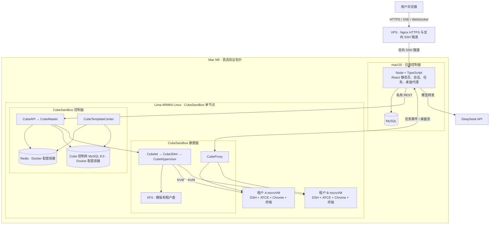

# Coke Super Agent 技术方案

2026-11-19 · 首版调研

## 首版决策

**一个 TypeScript 应用、一套业务 MySQL、一个 CubeSandbox 节点，每个个人租户一台 Linux microVM。** 同一台租户 VM 内运行 DeepSeek Harness、桌面、浏览器和终端。用户从 Coke Dots 风格的任务页发起工作、看进度、打开电脑和接管，刷新后可以重开任务及其结果。前端构建为静态文件，由 TypeScript 服务同源提供。

**Mac M5 已跑通开发用的本地 Cube 数据面，真实 Chrome/CDP 和完整桌面交互仍未验收。** Lima ARM64 Linux 内的 CubeSandbox v0.8.0 已启动真实 KVM microVM，官方 SDK 命令、文件和暂停恢复通过。已安装本地 60 秒 `VsockServerReady` shim 补丁；基于新预装镜像构建的 Cube 模板 READY，同一模板内 Pi 与 DSH 的 DeepSeek 文本任务也通过。经过应用认证 WebSocket 的 RFB 首帧和键鼠输入已在浏览器故障注入场景验证。2026-11-27 已验证 Cube 节点停止、启动后工作区 bind mount 自动恢复；两台原运行 VM 恢复运行、一台原暂停 VM 仍暂停，且私网节点 SSH 不可达、公网模型 API 可达。这证明节点与挂载恢复，不证明 Agent 任务、Chrome 配置或浏览器登录态的应用层恢复。产品网页可视验收、真实 Chrome/CDP、Browser/Computer Use、租户盘加密仍待验收，因此本地节点仍是开发环境，不存放真实租户数据。CubeSandbox 上游 PR [#2345](https://github.com/TencentCloud/CubeSandbox/pull/2345) 的创建/模板 readiness 修正不能解释本项目 Chrome 卡顿，本地继续使用已验证的 60 秒补丁。最新容量检查：110 GiB 专用 APFS 卷余约 13 GiB；专用卷未加密。 [实测记录](cube-preflight.md#2026-11-19-m5-本地单节点实测) · [nested-virt 排障](https://github.com/TencentCloud/CubeSandbox/blob/v0.8.0/docs/guide/troubleshooting/templates.md) · [ARM64/PVM 要求](https://github.com/TencentCloud/CubeSandbox/blob/v0.8.0/docs/guide/quickstart.md)

**2026-11-27 公网 DSH 任务和活动任务恢复验收通过。** 发布 `0.1.0-dev.20261127.2` 后，Alpha 通过公网应用提交真实 `deepseek-flash` 任务，Bash 写入文件、Alpha 下载内容完全匹配，Beta 对任务和文件均收到 404。发布 `.3` 后又在 Bash 正在执行时重启 API LaunchAgent；服务恢复后同一任务只重连一次 guest PTY、Harness 只启动一次，任务完成，Alpha 下载到的文件内容完全匹配，Beta 文件列表仍为 404。该任务从创建到 Bash 启动耗时 644 秒，总计 837 秒。旧 microVM 还需传输并安装 143.8 MB runtime。两次结果证明公网任务、产物、应用进程恢复、活动 DSH 任务续跑和租户 API 隔离，不证明新租户模板的预装状态。两台 demo VM 当前仍是 `running/failed`；Alpha 的 retained guest log 显示 Chrome 进程存活但 360 秒内没有监听本机 CDP 端口，底层原因仍未知。公网页面 HTTP 检查通过，但本轮 CUA 获取浏览器状态和选择公网浏览器均在 30 秒超时，网页点击式 UI 验收、桌面接管、Chrome/CDP、Browser/Computer Use 仍未通过。详细记录见[构建与运行故障记录](template-build-incident-2026-11-21.md#2026-11-27-release-010-dev202611273-active-dsh-recovery)和外部验收日志 `~/.local/share/csa-cube-node/build-logs/active-dsh-recovery-2026-11-27.jsonl`。

**Browser Use、Computer Use 和租户内终端默认可用。** 常规导航、点击、输入、运行命令和安装系统包直接执行。站点要求登录、验证码或同类身份验证时，Agent 暂停并提示用户接管同一台电脑。账号、任务、文件、浏览器配置和桌面连接始终归属租户。

Pi 与 DSH runtime 共用同一套电脑工具和操作规则；Pi 的任务提示也明确规定日常操作无需逐步批准，只在真实登录或验证码时交接。此规则不解除租户间隔离或认证。

## 调研结论

### Dots 的产品交互与 DeepSeek 的执行架构

OpenAI dots 提供持续可用的个人 Agent、后台任务、独立云电脑和任务更新。Coke 首版沿用自有 Coke Dots 的任务时间线、活动与文件入口、电脑画面和接管交互，采用 Coke Super Agent 自有视觉。一个账户看到一个持续的 Agent，任务可独立打开、追问与查看进度。 [OpenAI dots 官方介绍](https://openai.com/index/introducing-dots/)

DeepSeek Harness 团队原文把工作拆为负责交互和派发的 Router、独立上下文的 Worker，并讨论了事件过滤与直通、异步交互、计算与状态分离、Watchdog。开源原型是面向单个 GitHub 仓库的 Harness 插件，可选飞书，用 SQLite 保存编排状态，每个 Ticket 有自己的 DSH Session 与目录。文章的设计范围覆盖更多场景，原型 README 说明了发布版本与内部实现的差异。Coke 借用职责划分和恢复机制，使用现有的个人 Agent UI 与 MySQL。 [DeepSeek Harness 团队微信原文](https://mp.weixin.qq.com/s/zoS7GlReWPhfCjENGxXCdg) · [原型 README](https://github.com/deepseek-ai/dsh-superagent-prototype/blob/8c32a9dc5d72c033816c6a8110b37f40cf94fba4/README.md) · [原型架构与持久化](https://github.com/deepseek-ai/dsh-superagent-prototype/blob/8c32a9dc5d72c033816c6a8110b37f40cf94fba4/docs/007-architecture.md)

| DeepSeek 设计 | Coke 首版实现 |
| --- | --- |
| Router | Node 进程内的 TypeScript 模块，接住用户请求、登记任务、推送进度、把显式跟进路由到对应任务。基于任务 ID 和用户动作判断归属。 |
| Worker | DSH 是首版主验收 runtime，由 VM 内一个 TypeScript 服务启动；`CSA_AGENT_RUNTIME=pi` 可选启用 Pi，作为 Coke Dots/Grok Bot 既有 Pi runtime 的对照。两者都在同一租户 microVM 内运行，并复用任务目录、云电脑工具和持久化状态。每个租户首版同时跑一条任务，共享一套真实鼠标键盘与浏览器。不同租户可并行。 |
| 异步交互、事件路由 | 提交立即拿到任务 ID，页面订阅已持久化的进度。首版输入是用户请求及其跟进、停止和接管事件。工作链路跑通后可增加用户明确配置的定时触发。 |
| 存算分离、Watchdog | MySQL 保留产品状态，租户盘保留真实环境。应用进程内的定时检查对账正在创建的 VM、失联的任务、未回写的结果。根据记录恢复，外部结果不明时记为待核实。 |

两层是逻辑职责。一期用代码实现 Router，Agent runtime 负责实际执行和工具调用；DSH 保持主验收路径，Pi 做同环境对照，不以 host smoke 取代 microVM 验收。对照使用相同的无副作用任务、模型和 microVM，分别记录队列、VM 就绪、runtime 启动、首个模型响应、首个工具调用与结果持久化耗时。长驻模型 Router、多信道连接器、复杂事件判断与并行操作同一桌面的能力留待后续用真实需求验证。Mac 睡眠或离线时本机执行会中断，恢复后依靠保存的状态继续使用。

### CubeSandbox 的单机形态

首版验证固定 `v0.8.0`（`41748bb`）。CubeAPI 提供 E2B 兼容的 HTTP API。CubeMaster 负责调度与生命周期。CubeTemplateCenter 管理模板构建。Cubelet 在计算节点通过 containerd 及 CubeShim 启动 CubeHypervisor。VMM 用 Linux KVM 给每台 microVM 启动独立内核。CubeCoW 基于 XFS reflink 管理本地写层和快照，CubeVS 负责网络隔离，CubeProxy 路由客体端口和桌面连接。单节点安装把这些组件放在同一个 Linux 节点，提供一套上游的管理与计算能力。 [架构文档](https://github.com/TencentCloud/CubeSandbox/blob/v0.8.0/docs/architecture/overview.md) · [KVM 实现](https://github.com/TencentCloud/CubeSandbox/blob/v0.8.0/hypervisor/hypervisor/src/kvm/mod.rs) · [v0.8.0 发布](https://github.com/TencentCloud/CubeSandbox/releases/tag/v0.8.0)

Cube v0.8.0 单机安装包把 MySQL、Redis（以及可选 MinIO）作为本机 Docker 容器，通过 systemd 管理；CubeProxy 和核心程序按安装包配置运行。它们是控制面/单机部署的配套服务。租户沙箱不是这些 Docker 容器：计算路径是 Cubelet 使用 containerd Shim v2 调用 CubeShim，再由 CubeHypervisor 通过 KVM 启动独立 microVM。本次 Ubuntu 的 Compose v1 兼容错误发生在配套服务容器启动处，给该访客机安装 Compose v2 后 Cube 单机 quickcheck 通过。Mac 上现有 Docker 配置没有改动。 [v0.8.0 单机安装说明](https://github.com/TencentCloud/CubeSandbox/blob/v0.8.0/deploy/one-click/README.md) · [上游架构](https://github.com/TencentCloud/CubeSandbox/blob/v0.8.0/docs/architecture/overview.md)

目标方案让 TS 应用使用现有 MySQL 的 `coke_super_agent` schema，并先验证 Cube 能否共用该服务中独立的 `cube_mvp` schema。本轮为保护现有 MySQL 未更改其配置，Cube 使用同一 Lima Linux 节点内由安装包管理的 MySQL 8.0 和 Redis。MySQL 8.4 外部连接、schema 初始化和认证兼容性仍待验证，再决定是否共用。首轮关闭随包 MinIO，用文件存储。 [单机依赖配置](https://github.com/TencentCloud/CubeSandbox/blob/v0.8.0/deploy/one-click/support/docker-compose.yaml.template)

## 部署拓扑

这里有两个逻辑控制面：Mac 上的 Coke TypeScript 服务管理用户、任务和租户到 VM 的归属；同一个 Lima Linux 节点内的 CubeAPI、CubeMaster、CubeTemplateCenter 管理 sandbox 生命周期和模板。节点内的 MySQL/Redis 由 Docker Compose 启动并由 systemd 管理。Cubelet、containerd Shim、CubeShim、CubeHypervisor 与 KVM 构成创建 microVM 的计算路径。两者不需要拆成多台机器或 Coke 微服务；验证外部库兼容性后，再决定是否共用 Mac 上已有的 MySQL 服务。

1. **Mac 路径。** `infra/lima/cube-node.yaml` 在独立限容卷创建 ARM64 Linux 节点，`vmType: vz`、`nestedVirtualization: true`，无宿主目录挂载。客体 `/dev/kvm` 与真实 microVM 已通过。v0.8.0 的 10 秒 guest-agent 等待由本地 60 秒 shim 补丁处理；官方基础模板和桌面镜像模板均 READY。Cube 上游 PR [#2345](https://github.com/TencentCloud/CubeSandbox/pull/2345) 仍未合并，项目保留已安装并实测的 60 秒补丁。桌面镜像内 Pi 与 DSH 的 DeepSeek 文本任务成功；Chrome/CDP 尚未通过，也未进入 DSH 桌面任务。2026-11-26 修复了桥接器超时上限冲突和 guest 日志读取无截止时间两处诊断缺陷。校正后的 no-ptrace clone 中，39 字节 `Browser.getVersion` 命令已写入 pipe、回调在 935 ms 完成，Chrome FD 3/4 继承正确；但 300000 ms 命令期限内无 pipe 回包。9222 在等待中返回 `503 Chrome is starting`，Chrome 进程仍运行并增加 CPU ticks。旧版 420 秒配置生成 390000 ms 命令期限，超过 bridge 原有 360000 ms 上限，故那轮没有启动 Chrome；校验现已对齐。当前证据将故障限定在 Cube guest 内 Chrome 初始化/CDP 响应路径，原因尚未确定；嵌套虚拟化仍是嫌疑项。完整 Chrome/noVNC 桌面尚未通过。Cube 官方 PVM host kernel 仅 x86_64；原生 Apple backend issue [#975](https://github.com/TencentCloud/CubeSandbox/issues/975) 已关闭为 not planned。 [本地实测](cube-preflight.md#2026-11-19-m5-本地单节点实测) · [Chrome 事故记录](template-build-incident-2026-11-21.md#2026-11-26-chrome-timeout-contract-and-300-second-pipe-sample)
2. **容量与备选。** 上游单机要求至少 8 GB RAM。本机总内存 16 GB，目前 Docker Linux 客体报告约 7.75 GiB 总内存。先跑一台轻量桌面，再实测两台同时工作时的可用内存、swap 和首帧延迟。租户初始规格以 2 vCPU、2 GiB RAM 为测试起点。若嵌套 KVM 无法完成 Cube 实例启动或并发资源不足，改用一台带可用 KVM 的独立 Linux 节点，应用通过私有链路调用相同的接口。x86_64 节点要用对应架构的内核与桌面模板。
3. **统一接入。** 一个 `CubeSandboxClient` 按固定版本 `openapi.yml` 封装创建、查询、连接、暂停和快照。应用只接受自身的电脑 ID，从 MySQL 解析对应的沙箱和版本。管理 API 与 CubeProxy 仅在私有网络监听或转发，方便外层 Linux 在本机与独立节点间替换。 [Cube API 契约](https://github.com/TencentCloud/CubeSandbox/blob/v0.8.0/openapi.yml)
4. **公网入口。** 沿用已有 VPS 的 Nginx 和由 Mac 发起的 SSH 反向隧道。公网前缀为 `/super-agent/`；VPS 只将该前缀代理到 VPS 回环端口 `14331`，再由隧道送到 Mac Vite Preview `127.0.0.1:5174`。服务端统一处理登录、任务事件 SSE 和 noVNC WebSocket。2026-11-26 已在 VPS 实际加载的 TLS 站点配置中启用该 location，并由 Mac LaunchAgent 持久运行 API、Preview 与隧道；公网页面、资源、健康检查、匿名拒绝、Alice 登录/登出、认证后的 noVNC HTML 及 Secure Cookie 均已通过 HTTP 验收。入口 JSON access log 记录 Nginx request ID、URI（不含 query）、上游地址、状态和耗时；request ID 传到 API 后也用于应用错误日志并回传给客户端。此项只证明公网传输和认证，不代表已完成登录后视觉、noVNC 首帧/键鼠或 Agent 任务验收。CubeAPI、CubeProxy 和 MySQL 仍只经 Mac 应用侧私有连接。 [既有 Grok Bot 的 Nginx 配置](https://github.com/cokepoppy/coke-grok-bot/blob/f917138bbdc8821ec9045e6730d2d6abdd5253b8/deploy/vps/grok-bot.locations.conf)

## 云电脑与复用清单

CubeSandbox 自带 Ubuntu 22.04 图形桌面示例，使用 noVNC 并保留 `envd` 启动入口。该方案现在改为构建时预装：`images/coke-super-agent-desktop/Dockerfile` 基于 `cubesandbox-base:2026.16`，包含 XFCE、ARM64 Google Chrome、Node.js/npm、Python 3/venv 和 DSH/Pi runtime；Cube 从 registry 镜像生成模板。开发镜像分发走 Mac 回环私有 Registry：只绑定 `127.0.0.1:15001`，Cube 节点通过 Lima SSH 反向转发访问 `127.0.0.1:15002`，无需公开 GHCR 或新增服务。Docker build 需要 Mac HTTP 代理和仓库外 runtime bundle 缓存，镜像 build context 会在完成后删除。模板使用 `49983 /health` 检查 envd，租户 VM 建好后再由 TypeScript 控制面启动 XFCE、Chrome、VNC/noVNC bridge，并以 CDP 与 X11 检查桌面 ready。新镜像标记路径禁用 guest apt bootstrap；租户仍可在 Linux 终端主动使用 apt 安装额外软件。2026-11-24 本机 ARM64 镜像已构建并推入本地 Registry，digest `sha256:53d2c18f639182ee60487e0a7baa9ef8c4db253d6b11af8b72d37f311ae68179`，大小 776,863,558 bytes；禁网 Docker 容器完整 bootstrap 约 5 秒通过。Cube 模板 `tpl-827a52ee603c40f3992e40dd` READY，但从模板启动的真实 microVM 中 Chrome 未开放 CDP；GUI 和 headless 启动均未成功，根因仍待定位。 [CubeSandbox 桌面示例](https://github.com/TencentCloud/CubeSandbox/blob/v0.8.0/examples/ubuntu-desktop/README.md) · [CubeSandbox Dockerfile](https://github.com/TencentCloud/CubeSandbox/blob/v0.8.0/examples/ubuntu-desktop/Dockerfile) · [CubeSandbox 自定义镜像指南](https://github.com/TencentCloud/CubeSandbox/blob/v0.8.0/docs/guide/tutorials/bring-your-own-image.md)

| 复用来源 | 迁入内容 |
| --- | --- |
| Coke Dots `4213e76`，`src/web/ComputerView.tsx`、`src/web/TaskArtifacts.tsx`、`src/web/main.tsx` | 任务页、Activity、附件入口、桌面查看和接管状态。保留同源 API，重标品牌并接入新的任务及电脑状态。 [电脑组件](https://github.com/cokepoppy/coke-dots/blob/4213e769e49da7a479ab2ad186584c77b721fa69/src/web/ComputerView.tsx) |
| Coke Dots `4213e76`，`deploy/linux-desktop/` | XFCE、Xvfb、VNC/websockify、浏览器持久 profile、渲染探针与桌面 worker。将 Pod 生命周期和 PVC 交接改成 Cube 模板、真实桌面探针与租户盘。 [桌面源码](https://github.com/cokepoppy/coke-dots/tree/4213e769e49da7a479ab2ad186584c77b721fa69/deploy/linux-desktop) |
| Coke Grok Bot `f917138`，`deploy/desktop/` | 复用 DSH SDK 接入、`dsh-computer-plugin.mjs`、`computer-tools.mjs` 的工具注册、截图传图、浏览器目标选择和中止处理。DSH 独立使用它的锁定版本组作为验证起点，先在目标镜像确认兼容性。 [DSH 与电脑插件](https://github.com/cokepoppy/coke-grok-bot/tree/f917138bbdc8821ec9045e6730d2d6abdd5253b8/deploy/desktop) |
| Coke Grok Bot `f917138`，`src/server/tenant-store.ts`、`src/server/run-store.ts` | 复用 `mysql2` 的事务、会话归属校验和任务回写模式，按个人租户缩减表与状态。 [租户存储](https://github.com/cokepoppy/coke-grok-bot/blob/f917138bbdc8821ec9045e6730d2d6abdd5253b8/src/server/tenant-store.ts) · [任务存储](https://github.com/cokepoppy/coke-grok-bot/blob/f917138bbdc8821ec9045e6730d2d6abdd5253b8/src/server/run-store.ts) |

DSH 在 VM 内通过本地工具访问同一个 Chrome 实例和 X11 屏幕。Browser Use 用 DOM 语义定位、导航与操作。Computer Use 用完整屏幕截图、鼠标和键盘，能操作终端及浏览器以外的窗口。选 DeepSeek `deepseek-flash` 作为首个模型候选，官方支持视觉输入。验收需用配置的真实模型和 DSH 版本证明工具截图被模型收到并用于下一次点击或键盘动作。图片能力与工具结果的编码要一起测，最终选用能传图的官方协议。 [DSH SDK 项目](https://github.com/deepseek-ai/deepseek-harness) · [DeepSeek 视觉输入](https://api-docs.deepseek.com/guides/vision/)

### 接管与隔离

- **桌面共享。** Agent 操作时页面展示实时更新的画面。用户点击接管后，guest worker 暂停任务、收回 Agent 的工具权限并确认当前输入已停止，再开放同源 WebSocket 的 noVNC 输入。交还后关闭该输入连接、重新读取当前 Chrome 标签页，再继续原任务。摄屏探针保持窗口焦点，接管期间的登录画面、按键与凭据留在用户和 VM 之间。用首次画面解码与可见输入验证连接。
- **免审批与租户边界。** 测试账号登录后继承所属 VM 的全部常规电脑能力，只有实际网页登录或验证码提示自动接管。`allowPublicTraffic=false`，后端为选定 sandbox 的上游 HTTP 与 WebSocket 请求注入 `e2b-traffic-access-token`。浏览器从应用接收受信任的 noVNC 客户端和桌面数据。CDP、VNC 原始端口、`envd` 及通用 Cube 管理权限留在内部。 [CubeSandbox 私有访问](https://github.com/TencentCloud/CubeSandbox/blob/v0.8.0/docs/guide/restrict-public-access.md)
- **公网使用。** 客体正常访问公网和 apt/npm/PyPI。私网隔离验证覆盖同节点其他租户、宿主机、数据库、管理 API 和云元数据。模型调用由同一个 TS 服务的内部端点转发，以短期的 VM/任务凭证绑定当前租户。模型提供方密钥只由服务端保存，镜像与磁盘快照只包含租户自己的数据。 [CubeSandbox 出网策略](https://docs.cubesandbox.com/guide/network-policy)

## 任务、账号与恢复

初始化两个测试账号，各对应一个独立个人租户，密码由部署脚本生成并在 MySQL 存哈希。Web 用 HttpOnly 会话 cookie，所有 HTTP、SSE 和 WebSocket 入口用服务端会话解析 `tenant_id`。测试环境先走本机或私有入口。所有业务查询与下载同时校验所属租户，附件以授权后的文件流交付。

| MySQL 数据 | 内容 |
| --- | --- |
| `tenants`、`users`、`sessions` | 账号归属、登录凭据哈希、会话与有效期。 |
| `computers` | 以 `tenant_id` 为唯一键，记录节点、`sandbox_id`、模板版本、租户盘引用、当前代次及创建意图。 |
| `threads`、`messages` | 用户可恢复的对话和显式跟进。 |
| `runs`、`run_events` | 任务状态、关联的 DSH Session 和顺序事件。事件与状态同事务提交，SSE 按事件 ID 重连。产物文件留在租户盘，不把大文件复制进 MySQL。 |

### 链路日志与错误定位

`run_events` 是每条任务的持久化事件源：从 API 接收任务、队列调度、模型配置、Cube 控制面与 microVM、Linux 桌面初始化、guest runtime 安装/复用，到 DSH 初始化、模型调用、工具通知、接管和结果回写，都按同一 `tenant_id`、`run_id` 与递增序号记录。前端通过现有 SSE 流接收这些事件；“调试模式”显示完整链路、秒级时间、组件、阶段、耗时和可展开的结构化详情。失败阶段会在时间线顶部显示红色诊断卡，即使任务尚未完成也会立即提示。

同一事件以 JSON 行写到应用 `stdout`，字段包含时间、租户 ID、Run ID、序号、组件、阶段和级别，便于本机开发终端或部署时的服务日志收集器按 Run ID 检索。`stderr` 保留给启动、基础设施错误，以及事件无法写入 MySQL 时的降级诊断。敏感字段在持久化和打印前过滤/脱敏。日志不写额外文件或 Docker 容器，避免本机磁盘被日志占满；MySQL 保存给产品页面和任务恢复使用，标准输出用于运维检索。

任务文件放在 microVM 的 `/workspace/tasks/<threadId>`。同一个 TypeScript 服务通过 `GET /api/tasks/:runId/artifacts` 枚举该任务目录，并通过 `GET /api/tasks/:runId/artifacts/download?path=...` 流式下载；附加 `mode=preview` 可预览受支持的文件，HTML 在受限 CSP 与 sandbox iframe 中打开。两个路由都先按当前会话的 `tenant_id` 查任务，再连接该租户的 microVM。列表排除隐藏项和 SDK 明确标记的符号链接；下载前还会验证 guest 的规范路径必须位于对应任务目录且不是符号链接。单文件下载上限为 100 MiB、预览上限为 25 MiB。文件索引从持久工作目录动态读取，首版不加服务或 MySQL 表。

**主链路。** 用户发任务 → MySQL 记录 `queued` 并返回任务 ID → 调度器复用或拉起该租户的 VM → VM worker 以同一任务 ID 接单并持久化执行记录 → DSH 运行 → 产品状态和结果落 MySQL。任务能继续接收跟进或停止请求。需要接管时显示 `waiting_for_user`，交还原屏幕后恢复。最终结果、失败、取消和结果待核实各有可恢复状态。产品页读取电脑或历史只查状态，首次显式打开电脑或发任务才触发创建。

**并发与故障。** 用 MySQL 行锁和持久化创建意图串行发起 VM 创建，外部请求使用唯一的意图 ID 作为 Cube metadata。创建响应丢失时，以 metadata 查询现有实例并收养确认归属的 VM。结果仍不明就保持待核实，直到确认远端状态。重启后按任务 ID、VM 代次和 guest 日志对账，拒绝过期 worker 写回。网络重连、查询以及已落盘结果回写可安全重试。工具操作结果不明时先查实际页面或文件，避免重复产生外部动作。 [原型的执行恢复](https://github.com/deepseek-ai/dsh-superagent-prototype/blob/8c32a9dc5d72c033816c6a8110b37f40cf94fba4/docs/003-execution.md)

## 持久磁盘、容量与回退

1. **模板与运行盘。** Linux 节点挂载独立 XFS 数据盘到 `/data/cubelet`，验证 `reflink=1`。固定 OCI digest 和 Cube 模板版本，租户用各自的 CoW rootfs 写层。首版采用 Cube `timeout: -1` 避免 idle 到期销毁。暂停释放内存，要先确认任务与接管均已结束，再实测同节点恢复、`apt` 包保留和 Chrome 登录态。 [存储机制](https://github.com/TencentCloud/CubeSandbox/blob/v0.8.0/docs/architecture/overview.md#storage-layer) · [生命周期](https://github.com/TencentCloud/CubeSandbox/blob/v0.8.0/docs/guide/lifecycle.md)
2. **租户目录。** Linux 节点的专用数据树按内部租户 ID 建目录，验证 XFS 项目配额和目录隔离。Cube Host Mount 只把该租户目录挂到它的 `/workspace`，内含工作文件、浏览器 profile 和 DSH 工作目录。控制面负责路径、挂载目标与配额，guest 启动先验证挂载成功，再启动浏览器和 Agent。租户盘只能由本代 VM 写入，替换前停旧 VM；Host Mount 的文件生命周期独立于 VM。 [CubeSandbox Host Mount](https://github.com/TencentCloud/CubeSandbox/blob/v0.8.0/docs/guide/persistent-storage.md)
3. **恢复与回退。** 升级前，在退出 Chrome 并停止写入后，备份租户目录及对应 MySQL 状态。需要保留用户安装的系统包时，按需取租户专用的 `fs-only` rootfs 快照，创建替代 VM 时重新声明同一租户挂载。常规 VM 暂停恢复延续原系统包。损坏重建能恢复到最近有记录的 rootfs 检查点，租户盘数据以它自己的备份为准。快照绑定租户，选择旧模板时单独校验数据兼容性。备份存独立加密位置，至少做一次恢复演练，记录备份时间、模板和数据范围。 [CubeSandbox 快照语义](https://github.com/TencentCloud/CubeSandbox/blob/v0.8.0/docs/guide/snapshot-rollback-clone.md)
4. **控制磁盘增长。** 估算镜像拉取、模板转换、运行写层、日志、快照与恢复临时空间，再检查物理盘和 Linux 文件系统可用量。首轮从一个轻量模板与一台租户 VM 开始，近满时暂停构建和快照。显式限制每租户存储和日志大小，核对真实 `du`，同时计入文件的 CoW 分配。按版本清理本项目无引用的缓存和过期快照，保留正在用的模板与可验证的回退版本。外置数据盘和备份启用静态加密。

## 实现顺序和验收

每一步独立完成验证并合入 `main`，再开下一条功能分支。

| 次序 | 通过条件 | 当前状态 |
| --- | --- | --- |
| 1. 单节点实证 | ARM64 Linux 客体调用 KVM，CubeSandbox 启动真实 microVM；记录硬件、内核、版本和 XFS。验证外部 MySQL 8.4 兼容性。 | KVM、Cube v0.8.0、单 VM、SDK 命令/文件和暂停恢复通过。第 38 轮确认 VM restore/agent ready 约 0.3 秒，但 Python/websockify staged import 14–16 秒；nested-virt 是强假设，native ARM64 KVM 基线待验。外部 MySQL 待验。 |
| 2. 可用的租户电脑 | Linux 桌面、Chromium、终端、`sudo apt`、`node`、`python3` 可真实使用；通过产品 UI 验 noVNC 首帧、浏览器输入和终端。 | 已构建预装 ARM64 镜像并生成 Cube 模板 `tpl-f8982970681d4131becaa111`；clone 确认 Chrome/Node/桌面/DSH/Pi/pipe bridge 在镜像内，tenant boot 禁止 apt。pipe CDP 与官方常规 `--remote-debugging-port` 对照都失败，Chrome 主进程存活但 `/json/version` 不可用。Lima VZ 配置 `nestedVirtualization=true` 且 `/dev/kvm` 可见；嵌套虚拟化是首要嫌疑，但具体根因未知。noVNC 画面/输入、apt、真实 Browser/Computer Use 仍未验收，候选模板未切换到应用配置。详见[最新事故记录](template-build-incident-2026-11-21.md#2026-11-26-prebuilt-bridge-image-and-disposable-desktop-acceptance)。 |
| 3. DSH 任务闭环 | 从产品发送任务，由 guest 内 DSH 调用真实 DeepSeek。Browser Use 导航并抓取页面内容，Computer Use 根据截图操作非浏览器窗口，终端生成文件并交付。刷新后重新打开任务、进度和可下载的结果。验证进行中的跟进、取消和应用重启对账。 | 候选桌面模板 `tpl-f8982970681d4131becaa111` 内 DSH `0.2.2-rc.2` 已完成真实 `deepseek-flash` 文本任务：176.6 秒、69 条 trace、guest 状态 `done`，回复和文件均持久化；Pi `0.73.1` 文本任务也通过（47.4 秒、20 条 trace）。两项都未调用 Chrome 或电脑工具。旧模板历史任务曾完成截图与 Browser inspect，但不代表当前候选模板通过。Chrome `Browser.getVersion` 仍超时；导航、电脑操作、终端文件交付、跟进/取消、应用重启恢复仍未验收。产品任务页、debug 时间线和云电脑页已通过 Computer Use 登录 Alice 查看，这只验证 UI/API。 |
| 4. 接管与两租户 | 用可控的登录/验证码测试页验收“提示接管 → 用户输入 → 交还 → 继续原标签页与任务”。普通浏览和桌面操作全程直接执行。两个账号同时执行不同任务，分别写标记文件并保持各自浏览器状态，交叉访问任务、文件和桌面 WS 均被拒绝。完成租户盘与 MySQL 的恢复演练。 | 未开始。 |

第一阶段的 M5/KVM/Cube v0.8.0 单 microVM、官方 SDK 命令/文件调用、暂停恢复、公网认证入口和测试用户 UI 已通过。候选桌面镜像 `sha256:5646bb...` / 模板 `tpl-f8982970681d4131becaa111` 已完成 Pi 与 DSH 真实文本任务；Chrome pipe bridge 在 microVM 中最终因 `Browser.getVersion` 超时退出，失败前 Chrome 主进程仍为 runnable、30 个线程、内存约 27 MiB。2026-11-26 的新 GDB 诊断未拿到栈：采样器错误地按 `--remote-debugging-port` 寻找浏览器，而产品镜像使用 `--remote-debugging-pipe`；现已改为从 `/run/csa-desktop/session.pid` 沿进程树定位 Chrome，并把下一轮 CDP 超时缩至 90 秒。该修正尚未在 VM 实测，Chrome 阻塞位置仍未知。noVNC 首帧/键鼠、当前模板的 Browser/Computer Use、终端/apt、接管后继续、租户持久恢复和第二租户资源隔离仍未验收；项目尚未完成。

集成桌面与 direct-ELF 探针曾 runtime-verify 心跳、listener 重试、线程采样和 DevTools socket 的读取/响应差异。历史运行 `7c824587` 对齐 client peer/fd，记录 Chromium 读满请求但未对该 TCP fd 写回；这仅缩小到 post-read handler/callback，并未证明根因。2026-11-26 新模板又用 55-task strace 重现 `/json/version` 无响应；profile 权限正确、D-Bus session probe 成功、VMM 未见 panic。后续应围绕新证据找出 Chrome 初始化为何占用 CPU 并延迟 DevTools handler，不重复已有的宽范围 ptrace/GDB 采样。

**历史进度（2026-11-25）：** Cube 专用 XFS 当时为 80 GiB、外层 APFS 卷当时为 90 GiB；后续容量以 2026-11-26 记录为准。旧模板比较、pipe 探针和租户 pause/resume 跨节点重启证据保留在[事故记录](template-build-incident-2026-11-21.md#2026-11-25-read-only-comparison-of-the-two-desktop-template-images)。

**Chrome 调查更新（2026-11-25）：** 现有租户 microVM 的 Chrome 对 headless `about:blank` 和本地 data URL 都未完成渲染；同镜像/Chrome 在同一台 Lima 节点的 Docker 容器（2 vCPU/2 GiB）约 1 秒完成 data URL 渲染。Lima 节点是 VZ 4 vCPU/8 GiB Linux VM，再经 `/dev/kvm` 启动 Cube microVM。由此排除了“Chrome 镜像坏了”及简单的 microVM 2 核/2 GiB资源上限，但没有证明嵌套虚拟化是唯一根因。Mac 物理内存 16 GiB，本次观测时 swap 已用约 4.69/5 GiB，主机资源争用可能进一步放大延迟；缺少无并行负载基线，不能确认因果。Chrome 专属 PTRACE_SEIZE 被拒的机制仍未知。没有创建 VM、安装包、重建模板或调用 DSH。该次资源采样与后续同节点 Docker 对照已完成；当前根因仍未知，guest 时钟与定时器的最新检查见下方记录。项目仍在租户电脑验收前，不能算完成。

**同步资源采样更新（2026-11-25 11:49 UTC）：** Beta Chrome 超时期间，Lima CPU `some avg10` PSI 从采样前约 2.1% 升至约 15–17%，但 Lima 与 microVM 的 memory PSI 为 0，microVM CPU PSI 也为 0；Mac 总 CPU 仍有约 40–60% idle，系统内存压缩约 6.9–7.1 GiB、swap 已用约 5.1/6 GiB。这说明 Lima 内部调度等待可能是延迟的放大因素，不能据此认定根因。线程采样器把第二个样本安排在 Chrome 截止时间之后，宿主采样器也漏掉了 Lima Virtualization 进程的逐进程 CPU 行，下一步先修好采样器再决定是否需要原生 KVM 对照。 [采样记录](template-build-incident-2026-11-21.md#2026-11-25-bounded-chrome-render-with-mac-and-lima-resource-sampling)

**同节点对照更新（2026-11-25 12:12 UTC）：** 同一个 ARM64 桌面镜像、Chrome 158、UID 1000、2 vCPU/2 GiB 和离线 data URL，在 Lima 节点普通 Docker 容器中约 1 秒渲染成功；同镜像在 Cube microVM 内 35 秒无 HTML。采样期间 Lima/VZ 进程使用约 1.2–1.4 个 CPU 核，Lima CPU PSI `some avg10` 升至约 16%，Mac 仍有约 60–76% CPU idle，guest memory/CPU PSI 为 0。该对照将故障范围缩到 Cube microVM guest/kernel/VMM/nested-KVM 路径，不能区分其具体机制。临时镜像测试后已删除，Lima 根盘恢复约 3.6 GiB 可用。后续只读比较确认 PMU 初始化失败会由 VMM 自动降级处理；Alpha 与 Beta 当前 VM 的时钟源和 high-resolution timer 配置相同，具体记录见事故更新。项目仍未通过浏览器、桌面接管、DSH/重启恢复和双租户隔离的端到端验收。 [完整采样与对照](template-build-incident-2026-11-21.md#2026-11-25-same-lima-docker-control-and-profile-scoped-chrome-process-sample)

**最新桌面状态（2026-11-26）** Pi 与 DSH 文本任务已通过，桌面动作仍未通过。Chrome 的 `Browser.getVersion` pipe 命令在 300 秒内没有回复，尽管 39 字节帧写入成功且 Chrome FD 3/4 已确认；9222 bridge 反复返回 `503 Chrome is starting` 或无响应。临时对照给 Chrome 增加 `--disable-background-networking` 仍未在 300 秒内得到回复，因此不支持该参数是根因。Chrome 初始化为何在 Cube guest 中不回包仍待查，不能归咎于 DSH。最新诊断 clone 已自动清理；`Sandbox.list` 复查仍为两台既有 VM running、一台 paused；候选模板和应用设置未切换。完整记录见[300 秒 pipe 样本](template-build-incident-2026-11-21.md#2026-11-26-chrome-timeout-contract-and-300-second-pipe-sample)及[参数对照](template-build-incident-2026-11-21.md#2026-11-26-diagnostic-only-chrome-background-networking-comparison)。

**分层就绪验证（2026-11-26 20:14 CST）** 当前工作分支已把 VM、桌面和浏览器就绪状态分开。在临时 Cube VM 中，桌面状态为 failed 时，产品 API 发起的 Pi/DeepSeek 任务完成 Bash 文件写入和读取，文件可由所属租户下载，另一个租户访问得到 404。另一台临时 VM 注入浏览器进程退出后，应用仍能将桌面标记为 ready。经过应用认证 WebSocket，RFB 客户端读取了 1280×800 的真实桌面像素，并点击 guest 中的 Tk 输入框、输入标记；guest 窗口确认收到点击和完整文本。浏览器单独重试用测试用 HTTP bridge 验证了状态流转；真实 Chrome/CDP 仍未恢复。当前聊天的 Computer Use 返回本地浏览器不可用，因此产品网页可视操作尚未验收。临时 VM 和 MySQL schema 已清理，原有两台 VM running、一台 paused。见[分层就绪记录](template-build-incident-2026-11-21.md#2026-11-26-layered-readiness-and-input-verification)。

**2026-11-27 工作分支更新：** DSH 也已通过产品任务队列执行真实 DeepSeek/Bash 文件任务，所属租户可下载，另一租户得到 404。产品创建临时 VM 时已实测按租户挂载 XFS 目录，销毁原 VM 后替代 VM 重挂并读回文件；旧 VM 丢失或创建结果不确定时保留记录并阻止重复创建。此能力尚未发布，既有两台租户 VM 尚未迁移到新挂载。当前 XFS 为 `noquota`，专用卷未加密，仍须完成配额、加密和恢复演练。两个现有测试 VM 的旧 `allowOut=0.0.0.0/0` 已逐台修正，分别确认节点 SSH 私网端口被拒、DeepSeek 公网端口可达；这不等同于完整跨租户网络验收。见[持久化与网络记录](template-build-incident-2026-11-21.md#2026-11-27-workspace-safety-network-and-memory-diagnostics)。

**2026-11-27 性能对照：** 相同 ARM64 静态程序的 SHA-256 在 Lima 与 Cube VM 一致。两边纯整数运算与 `getpid` 接近，但 VM 中 32 MiB 首次触页约慢 25–36 倍、内存保护切换约慢 50–59 倍，10 次 fork/wait 约慢 24–43 倍。`MADV_HUGEPAGE` 确实分配了 32 MiB 大页，却没有使 VM 内的触页更快。两边内核和虚拟化层级不同，结果指向 guest 内存管理/VMM/嵌套虚拟化路径，不能单独证明 Chrome 卡住的直接原因。用户确认暂无独立 Linux KVM 节点，不重复之前的长时间 Chrome 试验。见[性能实测](template-build-incident-2026-11-21.md#2026-11-27-workspace-safety-network-and-memory-diagnostics)。

最终从已登录的 Coke Super Agent 网页完成上述任务和接管链路。每轮记录对应的 Git SHA、Cube 模板、DSH/模型版本、租户电脑标识、用户可见结果与端到端用例。KVM 探针、接口连通和桌面首帧用于定位各层问题，完整产品验收以真实任务结果、接管后继续和双租户数据为准。

### CubeSandbox 官方桌面/Chromium 参考（2026-11-24）

CubeSandbox 官方示例把 headless Browser Sandbox（Chromium + Playwright/CDP，端口 9000）和 Ubuntu Desktop Sandbox（GNOME + noVNC，端口 6080）分开。本项目采纳官方示例的构建时安装 OCI 镜像、Cube 再转换为模板的流程，不创建第二台 Browser Sandbox；noVNC 与 CDP 操作同一台租户 VM 的同一个 Chromium profile。官方 Dockerfile 以 `cubesandbox-base:2026.16` 为基底，启动脚本优先用 dummy Xorg、失败回退 Xvfb，并用 system D-Bus、`systemd-logind`、`dbus-run-session` 启动 GNOME。官方模板示例配置为 4 CPU、8 GiB 内存和 16 GiB writable layer；本项目先保留轻量目标，完成 GUI 性能与内存测量再决定是否采用 GNOME 原规格。上游 [#1505](https://github.com/TencentCloud/CubeSandbox/issues/1505) 记录 VNC 图形浏览在 PVM/nested virtualization 下的卡顿，Mac → Lima → MicroVM 仍需实测。

**最新生命周期进展（2026-11-24）：** 两个无 apt 的 disposable probe 都从 desktop-base-v2 创建并通过前台 PTY 持续监视；guest PID 1 是 Python，没有 systemd/journalctl/ps。VMM 在约 114 秒记录一次 `VmExit::Shutdown`；另一次即使 PTY 继续输出，Cube 仍在 host elapsed 136 秒报告 `unknown / Failed`。因此 PTY 命令自然结束不是充分解释，Cube `timeout=-1` 已请求但退出发起者仍未知。只在观察退出后清理临时 VM，未创建快照或改租户实例。下一步读取这两个 sandbox ID 对应的 CubeShim/VMM 日志并核对 base template 的 guest init；同时，生命周期退出检测已加到构建器但尚待 fresh builder 验证。预构建桌面镜像会避免每租户重复 apt，但不替代这项根因排查。详见[事故记录](template-build-incident-2026-11-21.md#2026-11-24-no-apt-foreground-probes-still-exit)。

节点只读日志现已对齐上述 shutdown 与 Cubelet TaskExit：两次 VMM `VmExit::Shutdown` guest uptime 分别为 114012ms 和 138742ms，后续 `kill_reason=request` 属于 probe cleanup。第三次 probe 的 PID 1 是 `/usr/local/bin/python3.12`（argv[0]=`python`，14 个参数），在 elapsed 132713ms VMM 再次 shutdown；该镜像没有 strace/ps/journalctl，不能从 guest 进程日志确认是谁调用关机。随后从 GHCR 拉取官方 `cubesandbox-base:2026.16` 并完成 rootfs 分发，但在进入镜像入口点前再次遇到 CubeShim `Receive event timeout after 10000ms`；guest kernel 在 10 秒墙钟内只前进到约 0.8 秒。Lima 配置为 `vz/aarch64/nestedVirtualization=true`，与 Cube 上游记录的 nested-KVM guest-agent 超时一致，当前判断是高度吻合但尚未通过延长 Shim deadline 实测的根因。PVM 不能作为这台 ARM64 Mac 的直接替代：Cube Quick Start 明确说 PVM host kernel 仅支持 x86_64；Cube 原生 Apple Virtualization backend 提案 #975 已被关闭为 not planned。不要把 `create_timeout_insec` 当成该内部 10 秒等待的配置。完整过程见[事故记录](template-build-incident-2026-11-21.md#2026-11-24-official-base-template-hits-nested-startup-handshake-deadline)。

### 2026-11-24 CubeShim readiness patch smoke

在独立 Cube 节点构建并原子安装了 v0.8.0 的 60 秒 `VsockServerReady` 补丁。官方 `cubesandbox-base:2026.16` 模板最终 READY；从模板创建的 Ubuntu 22.04 ARM64 测试 sandbox 执行 guest 命令成功，运行中 shim 的 SHA-256 与补丁二进制一致。直连 GHCR 的首次模板请求在 layer 下载中遇到 HTTP/2 `PROTOCOL_ERROR`，只给 TemplateCenter 临时注入本机 HTTP 代理后重试成功；代理 drop-in 已撤销，TemplateCenter 恢复 active，无代理环境。Cubelet 未重启，两台原租户 VM 全程保持 Up。该 smoke 验证了新 shim 的部署路径和基础模板启动，但没有人工制造超过 10 秒的 agent 延迟，也没有验证桌面、noVNC、Chromium/CDP 或 DSH。下一步依据 CubeSandbox 官方 Ubuntu Desktop 示例准备同一 MicroVM 内的 GUI/Chromium/runtime 镜像，先保持轻量资源规格并分别验收 guest-agent、envd、XFCE/noVNC、CDP 与 Agent Runtime。完整记录见[模板构建事故记录](template-build-incident-2026-11-21.md#2026-11-24-cubeshim-60-second-readiness-patch-and-official-base-validation)。

**Guest clock/timer update（2026-11-25 12:30 UTC）：** 对 Alpha 与 Beta 当前 VM 做只读比较：两者都运行 Cube guest kernel `6.6.119-cube.bm.guest.001`，Chrome `158.0.8127.88`，并使用同一组启动参数。guest 实际只提供/选择 ARM `arch_sys_counter`；命令行中的 `clocksource=kvm-clock` 未生效。`highres=off` 则确实关闭高精度定时器，两台 guest 的定时器分辨率均为 4 ms；Lima 宿主为 1 ns。Cube VMM 源码确认 PMU 不可用时会正常降级，所以 PMU warning 不是已证实故障。`highres=off` 可能影响 guest 调度时延，但还未验证它会导致 Chromium 无法渲染；不据此修改模板或重启租户 VM。详见[clock/timer 事故记录](template-build-incident-2026-11-21.md#2026-11-25-alpha-beta-guest-clock-and-timer-comparison)。

**此前验收状态（2026-11-26 clock patch）：** 本分支此前 `npm run build` 通过，MySQL 随机 schema 测试 14/14、Pi 合约测试 2/2、Cube 预检 Python 测试 12/12 通过；clock patch 候选 `tpl-317e7c852d714fb5aea77e8c` 已验证 `hres_active=1`、定时器精度 1 ns。更晚的桥接版镜像/桌面与 Pi 验证以本节下方记录为准。noVNC、VM 内 Browser/Computer Use、DSH 真实任务、桌面接管、跨重启租户数据、第二租户运行隔离和公网隧道仍待验收。历史问题细节见[clock patch 事故记录](template-build-incident-2026-11-21.md#2026-11-26-arm64-clock-patch-and-chromecdp-retest)。

**桌面验证更新（2026-11-26）：** 新预装镜像摘要为 `sha256:5646bb9396d51ae3d5834734d6d89e783d99a49bbef5503c912878c7b2556082`，模板 `tpl-f8982970681d4131becaa111` READY，应用配置仍未切换。最小 GUI pipe 探针曾在 201.5 秒收到 `Browser.getVersion`、339.5 秒完成页面 evaluate，但截图 360 秒内未返回；同镜像与 2 CPU/2 GiB 容器的截图用时 6.5 秒。产品 bridge 的 300 秒样本中，39 字节命令帧成功写入、Chrome FD 3/4 存在，但 Chrome 没有回包；`/json/version` 返回 503/超时。把 `--disable-background-networking` 仅加到诊断 clone 后，同样在 300 秒期限内无响应。后台网络参数不是已证实根因。此前 420 秒采样的 timeout 校验冲突和日志 collector 无限等待均已修正，bridge 关闭时的 pipe reset 也已处理。Chrome stderr 未捕获 FATAL；Crashpad 目录缺失仅为伴随观察，不能解释 CDP 超时。最新诊断 clone 清理成功，`Sandbox.list` 仍显示两台既有租户 VM running、一台 paused；候选模板和应用设置未切换。Chrome/CDP 根因未定，模板不应提升；noVNC、Browser/Computer Use、租户接管仍未验收。详见[300 秒 pipe 样本](template-build-incident-2026-11-21.md#2026-11-26-chrome-timeout-contract-and-300-second-pipe-sample)与[参数对照](template-build-incident-2026-11-21.md#2026-11-26-diagnostic-only-chrome-background-networking-comparison)。

**Agent Runtime 独立验收（2026-11-26）：** 同一候选模板的 Pi `0.73.1` 已完成 Browser/Computer 工具导入 smoke 和真实 `deepseek-flash` 文本任务（47 秒、20 条 trace）；DSH `0.2.2-rc.2` 也完成真实文本任务（176.6 秒、69 条 trace），两个 disposable microVM 均清理成功。Pi 与 DSH 的纯文本执行、模型调用和状态写回已分开验证。它们均未执行 Chrome/noVNC 的浏览器/桌面动作，因此 UI、人工接管、Browser/Computer 和用户页面的完整链路仍未验收。详见[Pi、DSH 与桌面分离验收记录](template-build-incident-2026-11-21.md#2026-11-26-dsh-real-text-task-on-desktop-template)。

**当前数据面容量（2026-11-27）：** Mac 专用 APFS 卷 `~/.local/share/csa-cube-node` 为 110 GiB、最新检查约余 13 GiB；Cube XFS 上次检查为 100 GiB、使用约 74%；节点系统盘曾达到 83%，归档并校验了 557,843,150 字节的已关闭轮转日志后约为 80%。节点重启和租户工作区 bind mount 恢复现已通过，但磁盘余量和系统盘水位仍需在镜像构建前检查；专用卷尚未加密，先不在此实验节点存放真实租户个人文件或登录态。详见[本轮事故记录](template-build-incident-2026-11-21.md#2026-11-27-workspace-safety-network-and-memory-diagnostics)。

**静态加密仍是上线门槛：** 2026-11-25 实机检查显示 Cube 专用 APFS 卷 `Encrypted: No`，macOS FileVault 也是 Off。CubeSandbox v0.8.0 的 Host Mount、Volume Plugin 与 snapshot 文档描述了数据挂载和生命周期，但没有声明静态加密保证；Volume Plugin 文档还明确说明 `private_data` 明文保存在数据库并转发。因此不能把 Cube snapshot、XFS 或 plugin metadata 当作已加密存储，也不能把明文密钥放进 `private_data`。在加密宿主存储及其密钥恢复流程验收前，不在此实验节点保留真实租户浏览器登录态或个人文件。 [CubeSandbox Host Mount](https://github.com/TencentCloud/CubeSandbox/blob/v0.8.0/docs/guide/persistent-storage.md) · [Volume Plugin](https://github.com/TencentCloud/CubeSandbox/blob/v0.8.0/docs/guide/volume-plugin.md) · [Snapshot lifecycle](https://github.com/TencentCloud/CubeSandbox/blob/v0.8.0/docs/guide/snapshot-rollback-clone.md)

**暂停快照跨节点重启验证（2026-11-25）：** 在零活动任务时，通过 SDK 依次暂停 Alpha 与 Beta；Cube `Sandbox.list` 将两者和原有第三台 sandbox 都报告为 `paused`。优雅停止并重新启动 Lima `cube-node` 后，三个 paused 状态仍存在；随后仅恢复 Alpha/Beta，二者重新显示 `running`，第三台仍为 paused。该实测证明这两个当前 sandbox 可通过 Cube pause/resume 生命周期跨本次节点重启恢复，范围不扩展到所有未来故障、当前 Chrome 修复或未挂载到 sandbox 的租户目录。完整运维记录见[扩容窗口被 Docker Desktop 挂载占用拦截](template-build-incident-2026-11-21.md#2026-11-25-volume-resize-window-blocked-by-docker-desktop-mount)。

## Git 与发布目录

- 以 `origin/main` 为起点，每次只开一条功能分支。完成适用验证后提交并快进合入 `main`，推送并核对远端提交，回到 `main` 后再开始下一项。
- 每次实际发布建立 `releases/<版本>/`。目录只放准备、部署、验收、回退所需的脚本，脚本锁定 Git SHA、Cube 版本、OCI digest 和模板版本。镜像、构建产物、安装包、快照、数据库备份和浏览器数据存放在它们各自的制品或数据位置。
- 发布前检查磁盘空间、在跑任务、租户卷与回退指向。应用发布与模板更新各自校验版本，通过已登录产品路径验证滚动前后的桌面、任务和用户数据。旧版本回退以已验证的应用版本、模板及兼容的数据备份为准。
